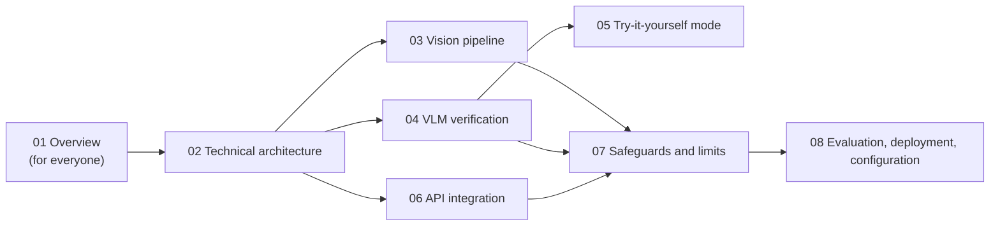

# Nadjet AI Documentation

This documentation describes **everything the AI does in Nadjet**, from the surveillance camera to the operator's screen. It was written by reading the code of the `nadjet/` repository (`dev` branch). When in doubt, **the code wins**: each document cites the source files involved.

> French version: [`../00-README.md`](../00-README.md)

## How to read this documentation

The documents are split by **level of detail** and by **topic**, so everyone reads only what they need.

| # | Document | Audience | Question it answers |
|---|---|---|---|
| 01 | [Overview](01-overview.md) | Everyone (jury, project lead, operator) | What does the AI do end to end, and why can it be trusted? |
| 02 | [Technical architecture](02-technical-architecture.md) | Developers | Which processes, servers, contracts and failures? |
| 03 | [Vision pipeline](03-vision-pipeline.md) | Vision developers | How do we go from an RTSP stream to an "incident candidate"? |
| 04 | [VLM verification](04-vlm-verification.md) | AI developers | How does the Qwen3-VL model confirm or reject a candidate? |
| 05 | [Try-it-yourself mode](05-try-it-yourself-mode.md) | Developers, demo | How does a visitor upload a video or connect a phone? |
| 06 | [API integration](06-api-integration.md) | Backend developers | What happens to a candidate once it reaches the API? |
| 07 | [Safeguards and limits](07-safeguards-and-limits.md) | Everyone | What makes the AI reliable, and what is not yet measured? |
| 08 | [Evaluation, deployment, configuration](08-evaluation-deployment-configuration.md) | Developers, ops | How do we run, tune and measure the system? |

### Suggested reading paths

- **Understand in 10 minutes**: 01.
- **Prepare a presentation**: 01, then the "Safeguards" and "Limits" sections of 07.
- **Take over the vision code**: 02, 03, 04, then 08.
- **Take over the backend**: 02 (contracts section), then 06.

## Terms to know

| Term | Meaning in Nadjet |
|---|---|
| **Candidate** | A suspicious event sent by a worker to the API (`IncidentCandidate`). It is not yet a validated incident. |
| **Rule** (trigger) | A geometric test on tracked objects: `collision_candidate`, `hard_stop`, `stalled_vehicle`, `pedestrian_on_road`. |
| **Detector** | RF-DETR Medium: finds vehicles and pedestrians in each frame. |
| **Tracker** | ByteTrack: gives each object a stable identifier from frame to frame. |
| **VLM** | Vision-language model Qwen3-VL-8B-Instruct-FP8, served by vLLM on the Brev GPU. It "watches" a short video and answers a question. |
| **Verifier** | The VLM's role when a rule has fired: confirm or reject. |
| **Sweep** | The VLM's role when no rule has fired: look at the camera every 5 s. |
| **AI status** | `confirmed`, `probable`, `possible` or `insufficient_evidence`. |
| **Packet ring** | Buffer of the last ~20 seconds of encoded video of each camera. |
| **Brev** | The NVIDIA provider of the rented GPU. The **only** place where AI inference is allowed to run. |
| **Requirements** | The `FR-VIS-xxx` (PRD.md) and `TD-xx` (docs/11-technical-decisions.md) identifiers cited throughout. |

## Sources of truth

1. `services/vision/src/nadjet_vision/`: the vision code (workers, rules, VLM).
2. `services/api/src/nadjet_api/incidents/`: reception and processing of candidates.
3. `packages/shared/src/nadjet_shared/`: the exchange contracts (Pydantic).
4. `models.lock.yaml`: the exact models, their checksums and licences.
5. `PRD.md` (what) and `docs/11-technical-decisions.md` (how).

> The repository also contains an older `Ai_Docs/` folder (jury-oriented summary). This `Nadjet-Docs/AI/` documentation complements it with technical detail verified against the code.
