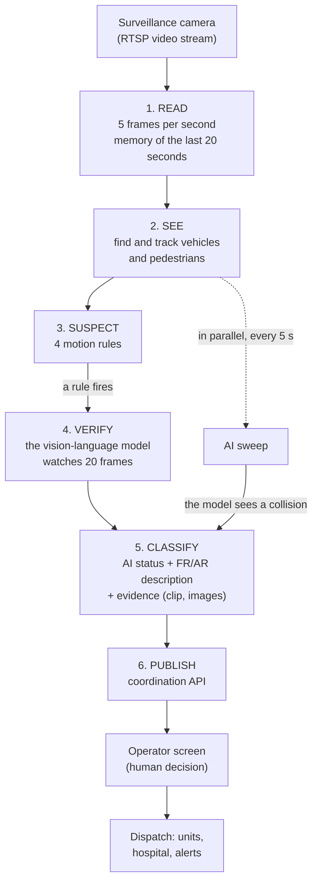
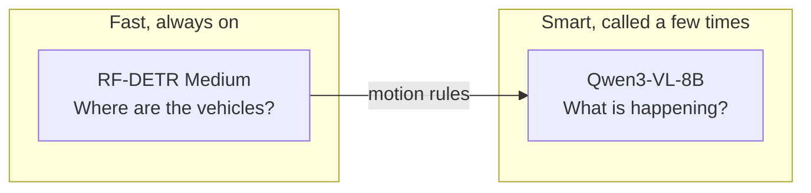
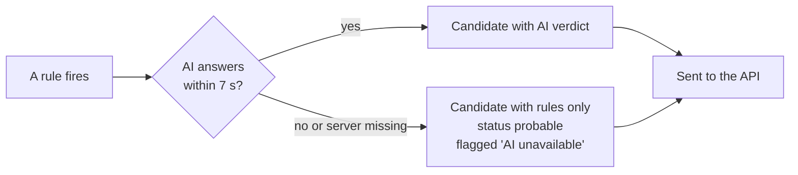

# 01 — Overview of Nadjet's AI

> This document is deliberately **not very technical**. It explains what the AI does, in what order, and why it can be trusted. Details are in documents 02 to 08.

## The idea in one sentence

Nadjet watches the **surveillance cameras already installed**, spots a crash using **motion rules**, has it **confirmed by an AI that understands video**, then hands the operator a ready-to-handle incident, with **evidence** and an **honest confidence level**. A human always decides.

## The problem solved

A road crash on a camera is only seen if someone is looking at the screen at the right moment. Nadjet replaces this "permanent watching" with an AI, without installing new hardware and without training any model: we reuse open-source models that are already trained.

## The general flow

### The 6 steps in plain language

1. **Read.** Each camera is read continuously. The AI analyses only 5 frames per second (enough to track a vehicle) and keeps the last 20 seconds of video in memory, which will serve as evidence.
2. **See.** A first model (RF-DETR) draws a box around every car, truck, bus, motorcycle and pedestrian. A tracker (ByteTrack) gives them a stable number: "vehicle no. 7".
3. **Suspect.** Four simple rules watch the motion: two vehicles that touch and then stay still, a sudden stop, a vehicle stopped too long in a lane, a pedestrian on the roadway. A rule that fires creates a **candidate**.
4. **Verify.** The second model (Qwen3-VL) receives a short video of 20 numbered frames around the suspicious moment. We ask it a **neutral** question: "is a collision visible?". It can answer yes, no, or "I cannot judge".
5. **Classify.** The system combines the rule and the model's answer into a status: `confirmed`, `probable`, `possible` or `insufficient_evidence`. A video clip and 6 images are added as evidence.
6. **Publish.** The incident reaches the API, then the map and the operator's queue. The operator validates, rejects or dispatches.

In addition, an **AI sweep** queries the model every 5 seconds on each camera, even when no rule has fired. It catches what the rules cannot see, for example a single vehicle that rolls over.

## Two models, two roles

| Model | Role | Frequency | Limit |
|---|---|---|---|
| **RF-DETR Medium** | Find objects in each frame | 5 times per second, per camera | Does not understand the scene: two touching boxes are not necessarily a crash |
| **Qwen3-VL-8B (FP8)** | Understand a short video and answer in JSON | On candidate, and every 5 s in sweep | Slower (seconds): cannot be called on every frame |

Both run on **a single rented NVIDIA GPU** (Brev instance `nadjet-gpu`). No model is trained by the team.

## The statuses: what the AI claims, and what it does not

| Status | Meaning | Condition |
|---|---|---|
| `confirmed` | The rule **and** the model agree, with high certainty | A rule fired **and** probability of "yes" ≥ 80 % |
| `probable` | Solid signal but not certain | Rule + "yes" between 50 and 80 %, **or** AI unavailable (rule alone), **or** two consecutive positive sweeps |
| `possible` | Weak or contradictory signal | "yes" < 50 %, or the model says "no" despite the rule, or a single positive sweep |
| `insufficient_evidence` | Unusable image (night, blur) | The model answers "I cannot judge" |

**Golden rule: the AI alone never confirms.** For an incident to become a confirmed `collision`, it takes a motion rule **and** a model more than 80 % sure. The sweep alone caps at `probable`.

## What happens when the AI goes down?

A candidate is **never lost or blocked** because the AI is slow or absent. It leaves with only the rule signals, and the operator's screen clearly shows that the AI could not judge.

## Why it can be trusted

- **Two independent signals.** Geometry (rules) and understanding (model) correct each other.
- **Neutral question.** The model is never told there is a crash. "No" is a valid answer.
- **Measured confidence.** The certainty level is not what the model says about itself: it is the **probability of the word "yes"** read from its internal computations.
- **Cited evidence.** Each finding by the model cites the numbers of the frames that prove it. With no valid frame, the finding is removed.
- **Nothing medical.** Any text about injury, death or health condition is removed. The AI lists what it cannot see (the occupants of the vehicles, for example).
- **Nothing invented.** No detection, incident or confidence value comes from hardcoded data. Checked automatically in CI.
- **Tamper-proof evidence.** The video clip is an exact copy of the stream. Its SHA-256 fingerprint is chained into a signed log.
- **A single provider.** All inference runs on the team's Brev instance. No third-party API, no hidden fallback.

## What the operator sees

- An incident with its **AI status** and an "uncertain" marker when caution is needed.
- A confidence level in three tiers (low, medium, high), never a misleading percentage.
- A description in **French and Arabic**, the images that justify each finding, and the list of what the AI could not assess.
- The camera's **annotated stream** (boxes, numbers, speeds): the operator sees what the AI sees.
- A **priority P1 to P4** explained rule by rule.

## The "Try it yourself" mode

A visitor can upload a video (60 s maximum) or connect their phone camera. The same pipeline analyses it, in an **isolated sandbox** separate from the real database: the result never enters the real incident queue. Details in [05](05-try-it-yourself-mode.md).

## What is not yet measured

To stay honest: the model's **real latency**, the **0.8 / 0.5 thresholds** and the **detection and false-alarm rates** are not yet quantified (the `eval/results/` folder is empty at the time of writing). Do not quote any percentage until `make eval` has produced a file. See [07](07-safeguards-and-limits.md).

## Going further

- Architecture, processes, contracts: [02](02-technical-architecture.md)
- The rules and the video: [03](03-vision-pipeline.md)
- The vision-language model: [04](04-vlm-verification.md)
- What arrives in the API: [06](06-api-integration.md)
