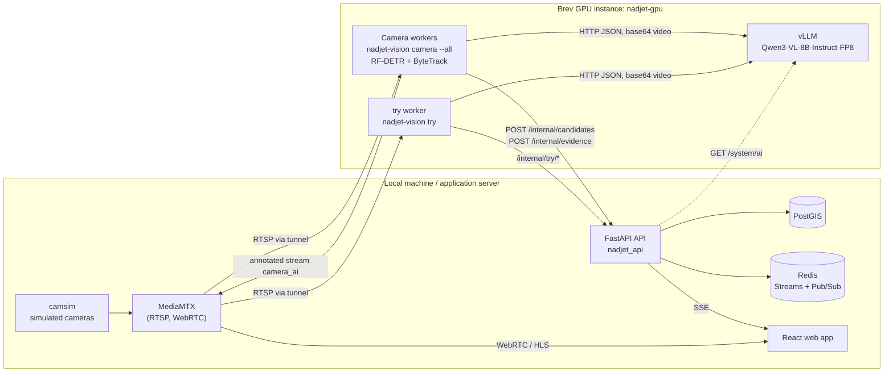
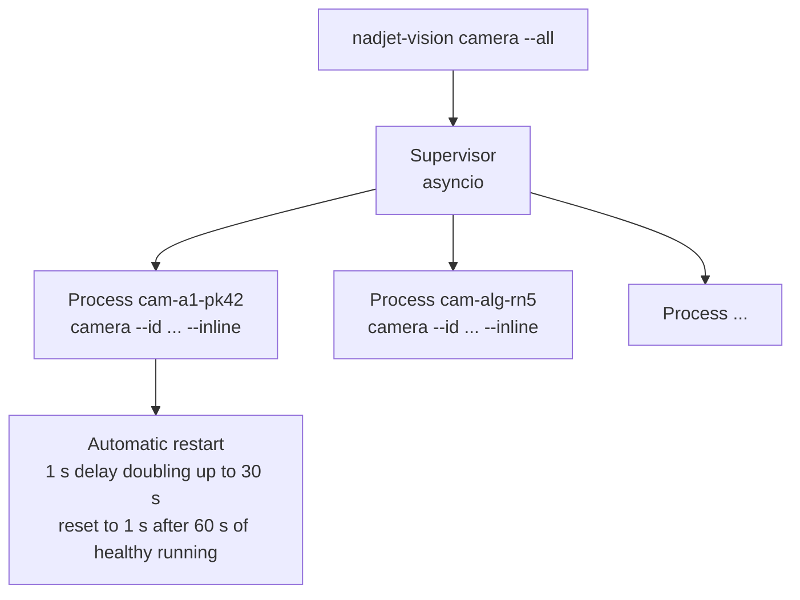
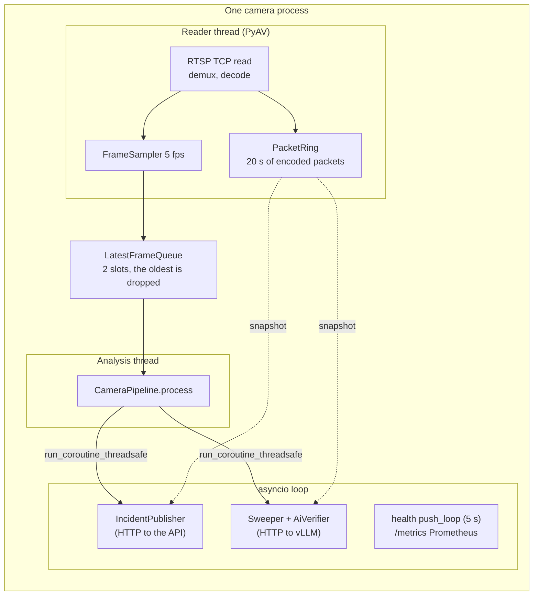
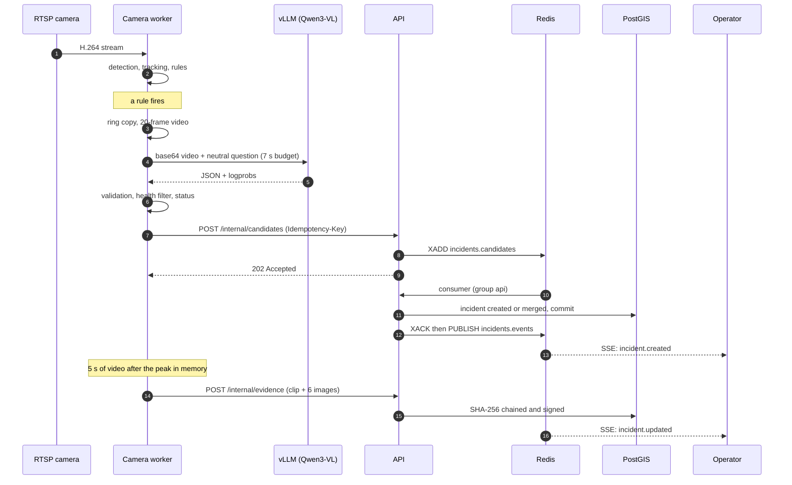
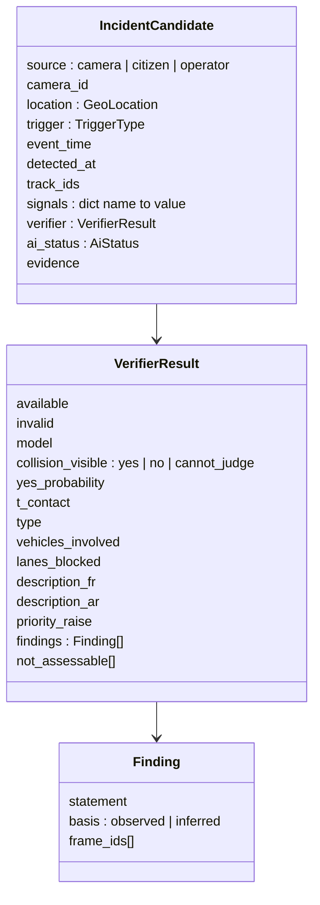

# 02 — Technical architecture of the AI

> This document describes **the pieces and how they fit together**: Python packages, processes, threads, servers, exchange contracts and behaviour on failure. Algorithmic detail is in [03](03-vision-pipeline.md) and [04](04-vlm-verification.md).

## 1. Where the AI lives in the repository

| Path | Role | Note |
|---|---|---|
| `services/vision/src/nadjet_vision/` | Vision workers, rules, VLM client, evidence, evaluation | The core of the AI. Heavy GPU dependencies isolated in the `gpu` extra (`rfdetr`, `supervision`, `trackers`, `av`) |
| `packages/shared/src/nadjet_shared/` | Pydantic contracts (`IncidentCandidate`, `VerifierResult`, etc.) | Source of truth for worker ↔ API exchanges |
| `services/api/src/nadjet_api/incidents/` | Candidate reception, merging, priority, evidence | See [06](06-api-integration.md) |
| `services/api/src/nadjet_api/tryit/` | Job queue and sessions of the sandbox | See [05](05-try-it-yourself-mode.md) |
| `services/api/src/nadjet_api/system/routes.py` | `GET /system/ai`: is the AI answering? | The API calls `BrevVlmClient.check()` |
| `deploy/gpu/compose.yml` | vLLM, camera workers, "try" worker on the Brev instance | Docker Compose |
| `models.lock.yaml` | Exact models: SHA-256 checksums, Hugging Face revision, licences | Verified at load time |
| `eval/` | Held-out clips and evaluation script | See [08](08-evaluation-deployment-configuration.md) |

## 2. Component view



Key points:

- **The vision workers run on the Brev GPU**, next to vLLM. They read the cameras and talk to the API through **SSH tunnels** (`make brev-tunnel`): nothing is publicly exposed.
- **A single vLLM server** serves all cameras and the "try" worker. Port 8000 only listens on the instance's `127.0.0.1`.
- **The browser never talks to Brev.** The API queries the AI status (`GET /system/ai`): no address or credential leaks to the client.

## 3. Process model of a camera

A **supervisor** (`supervisor.py`) starts **one process per camera**. A failure of one camera does not affect the others (requirement NFR-REL-001).



Each camera process (`run_worker` in `pipeline.py`) combines three lines of work:



Why this separation:

- **The reader never stops**: it decodes and feeds the packet ring even when analysis is slow.
- **The 2-slot queue drops the oldest frame** (`LatestFrameQueue`): analysis always processes the most recent frame, no lag accumulates.
- **Network calls (API, vLLM) are asynchronous** and launched from the analysis thread with `run_coroutine_threadsafe`: a slow answer never blocks analysis (`publish.py`, `sweep.py`).
- **An exception on one frame is logged and ignored** (`analysis_loop`): a faulty frame does not stop the camera.

## 4. Complete sequence of a candidate



Two important ordering choices:

1. **The candidate is verified by the AI before being posted** (`IncidentPublisher._send_candidate`). The operator therefore never sees a status that changes afterwards.
2. **Evidence follows the candidate**: the clip is only cut when the ring contains 5 s after the peak (`_flush_evidence`). Both are linked by the same **idempotency key**.

## 5. Exchange contracts (`packages/shared`)

The Pydantic models in `nadjet_shared/events.py` are the **source of truth**. `contracts/` (OpenAPI + JSON Schema) is **generated** by `make gen` and is never edited by hand.



| Enumeration | Values |
|---|---|
| `TriggerType` | `collision_candidate`, `hard_stop`, `stalled_vehicle`, `pedestrian_on_road`, `ai_sweep`, `citizen_report`, `operator_report` |
| `AiStatus` | `confirmed`, `probable`, `possible`, `insufficient_evidence` |
| `CandidateSource` | `camera`, `citizen`, `operator` |

`signals` contains the **named measurements** of the rules (for example `speed_before`, `stopped_s`, `overlap_iou`, `bus_involved`, `stopped_in_lane`). These names are read back by the priority computation on the API side ([06](06-api-integration.md)).

## 6. Idempotency keys

`candidate_key(camera_id, event)` (in `publish.py`) computes a **deterministic** key:

```
{camera_id}-{sha256("{camera}|{trigger}|{peak_wall_ms}|{track_ids}")[:40]}
```

- Re-sending the same event **never** creates a second incident.
- A restarted worker that re-detects the same crash gets another peak time, hence another key: it is the **API-side merge** (60 s, 50 m) that avoids the duplicate.

## 7. Sending to the API: retry policy

| Send | Delays between attempts | Particularity |
|---|---|---|
| Candidate (`/internal/candidates`) | 0.5 s, 1, 2, 4, 8 s then give up (logged and counted) | 4xx errors are final, 5xx and network errors are retried |
| Evidence (`/internal/evidence`) | 1, 2, 4, 8, 8 s | A **409** (candidate not yet saved by the consumer) is retried |

No send blocks analysis. When the worker stops, `aclose()` waits up to 30 s for in-flight sends. Without `NADJET_INGEST_TOKEN`, the worker refuses to publish and logs it.

## 8. Health and supervision

Each worker builds a `CameraHealthReport` (`health.py`) and:

- **pushes it every 5 s** to `POST /internal/camera-health`, and immediately when the fault state changes;
- exposes it in **Prometheus** format on `/metrics` (port `NADJET_METRICS_PORT_BASE + index`, 9100 by default);
- declares a **fault** if no frame is analysed for **10 s**: `stall` (stream open but silent) or `disconnect` (stream closed). The reason stays until the next frame.

Latencies measured per stage (median of the last 50 frames): `decode`, `detect`, `track`, `annotate`.

## 9. Failure matrix

| Failure | Behaviour | Visible to the operator |
|---|---|---|
| vLLM server unreachable or slow (> 7 s) | `unavailable` result; for 30 s, following candidates skip the AI immediately | Yes: "AI unavailable", status `probable` (rules alone) |
| Model answer invalid twice | `invalid` result with a fallback FR/AR description built from the rule | Yes: "invalid analysis, human assessment needed" |
| Camera without frames for 10 s | `stall` or `disconnect` fault, reconnection with 1 s → 30 s delay | Yes: `camera_fault` |
| Camera process crashes | Restarted by the supervisor (1 s → 30 s); other cameras continue | Camera fault if prolonged |
| API unreachable | Retries with delays; give up after 5 attempts (counted in `PublishStats`) | No, but logged as an error |
| Annotated-stream ffmpeg fails | Delayed restart (1 s → 30 s), fallback from `h264_nvenc` to `libx264` if it fails before the first frame; the raw stream continues | Annotated stream missing for a while |
| Redis or API consumer down | Candidates stay in the Stream; automatic recovery, moved to the dead letter after 10 deliveries | Delay, never loss |
| AI endpoint outside the allowed list | `InferenceConfigError` at client start-up: flat refusal | Configuration error |

## 10. The "Brev only" rule

`inference.py` (`assert_brev_endpoint`) only accepts:

- `localhost` or a **loopback** address (`127.0.0.1`, via `make brev-forward`);
- a host explicitly listed in `NADJET_VLM_ALLOWED_HOSTS`.

Any other host raises an error. The `scripts/check-integrity.sh` script forbids adding another AI provider in CI. When Brev is not available, the system displays "AI unavailable" and does not silently degrade.

## 11. Implementation principles

- **Pure, testable logic**: rules, status, speed, merge and priority are network-free functions, tested with synthetic tracks.
- **Dependency injection**: `CameraPipeline` receives detector, tracker and publisher; tests use fakes (no GPU card needed).
- **Lazy heavy imports**: `av`, `rfdetr`, `supervision`, `cv2` are only imported where used, so local tools and CI run without a GPU.
- **Python 3.12, strict mypy, Pydantic v2** at the boundaries, configuration through `NADJET_*` variables ([08](08-evaluation-deployment-configuration.md)).
