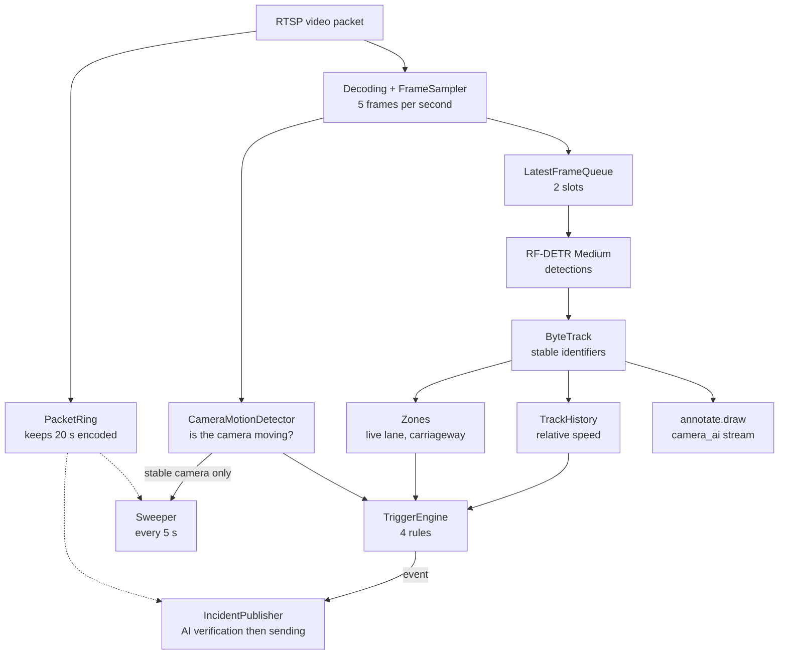
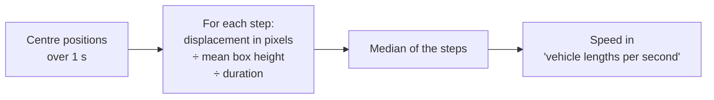
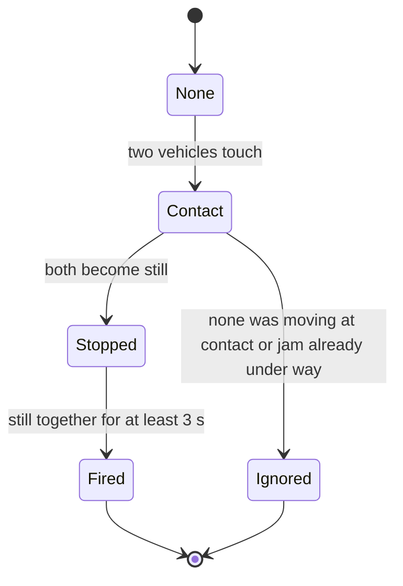
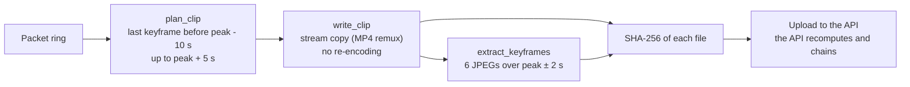

# 03 — The vision pipeline: from camera to candidate

> Everything that happens **before** the vision-language model: stream reading, detection, tracking, speed, zones, camera motion, trigger rules, evidence and annotated stream. Code: `services/vision/src/nadjet_vision/`.

## 1. Per-frame pipeline view

Orchestration: `CameraPipeline.process` (`pipeline.py`) runs these steps in this order for each sampled frame.

## 2. Reading the stream (`ingest.py`, `worker.py`)

| Element | Behaviour |
|---|---|
| Reading | PyAV over RTSP in **TCP**, 5 s open and read timeout. A frozen stream (session open, no more frames) is detected by this timeout and triggers reconnection |
| Sampling | `FrameSampler` picks frames according to the stream clock (PTS), at **5 frames/s** whatever the camera's frame rate. A clock jump backwards (reconnection, looping video) resets the counter |
| Queue | `LatestFrameQueue(maxsize=2)`: when full, the oldest frame is dropped and counted (`dropped`) |
| Reconnection | 1 s delay, doubled up to 30 s; reset to 1 s if the stream had delivered frames |

### The packet ring (`PacketRing`)

This is the worker's **video memory**: the **last 20 seconds of encoded H.264 packets** (`NADJET_EVIDENCE_BUFFER_S`), never decoded.

- It **always starts on a keyframe**: a clip can only be decoded from a keyframe. Trimming keeps the last keyframe that is at least 20 s old, so the ring can hold slightly more than 20 s.
- Hard cap of 1,800 packets (`15 × 120`) so a stream without keyframes does not grow without limit.
- A backwards jump of the decoding clock (reconnection) **empties the ring**: two RTSP sessions never mix in a clip.
- It serves three purposes: **evidence**, the **video sent to the VLM**, and the **sweep**.

`StreamInfo` stores codec, size, `extradata` and a small Matroska "template" file carrying the stream's exact parameters (SPS/PPS). RTSP cameras send these parameters out of band (SDP): without this template, the remuxed clip would no longer decode.

## 3. Detection (`detect.py`)

- **RF-DETR Medium**, COCO weights, Apache-2.0 licence.
- Classes kept (RF-DETR COCO identifiers): `person` (1), `car` (3), `motorcycle` (4), `bus` (6), `truck` (8). Everything else is ignored.
- Confidence threshold: `NADJET_DETECTOR_THRESHOLD = 0.4`. Degenerate boxes are discarded.
- A box's **anchor point** is its **bottom centre**: where the object touches the road. It is what zones use.
- Weights are downloaded once then **verified by SHA-256** (`models.lock.yaml`) before loading. A modified file is refused (`ModelWeightError`).
- The detector sits behind the `Detector` protocol: replaceable, and replaced by a fake in tests.

## 4. Tracking, speed, zones, motion (`track.py`)

### Tracking

**ByteTrack** (`trackers` package, Apache-2.0) runs at the analysis rate. Detections not yet confirmed receive identifier -1 and are not reported.

### Relative speed

The unit is **box heights per second** (`h/s` on screen). It needs **no camera calibration**, so it works on any view. Trade-off: no km/h.

### Zones

Each camera can have drawn zones (`data/zones/`): a **carriageway** (`carriageway`) and **live lanes** (`live_lanes`). Membership is a simple "point in polygon" test (ray casting) on the anchor point, rescaled if the stream resolution differs from that of the drawing.

### Camera motion

`CameraMotionDetector` measures the global shift between two reduced grey frames (160 px wide) by **FFT phase correlation**. A shaking or panning camera shifts the whole image; vehicles only occupy a small part of it.

- "Moving" = shift ≥ 2 px on **2 of the last 3** frames.
- Back to calm after **3 calm frames** (no flicker).
- While moving, **rules stay silent** and the sweep is not started (requirement FR-VIS-011).

## 5. The four rules (`triggers.py`)

One `TriggerEngine` per camera receives one `Observation` per frame (tracks, speeds, zones, motion) and returns the `TriggerEvent`s that fired. No rule reads a file name, a fixed clock or a random number (FR-VIS-020).

### 5.1 Collision candidate (`collision_candidate`)

- **Contact**: box IoU > 0.05, **or** distance between centres < 0.6 × mean box width.
- **A vehicle was moving at contact**: recent speed ≥ 0.5 length/s, otherwise it is a "static" contact (parked or queued vehicles) and the rule is ignored.
- **Anti-jam**: if ≥ 30 % of the other vehicles were already slow at the moment of contact, it is ignored.
- **Joint stop**: both tracks under 0.1 length/s for ≥ 3 s, after confirmation over 3 frames.
- A contact stays "relevant" for 10 s after the last overlap.
- `event_time` = **first contact**.

### 5.2 Hard stop (`hard_stop`)

- Speed **lost by more than 70 %** within ≤ 1 s, then still for ≥ 2 s. The speed before the stop must exceed 0.5 length/s.
- **Anti-jam**: if ≥ 30 % of the *other* vehicles also slowed, the rule is suppressed. This share is read **1 s after the impact** (speed smoothing lag) and not at firing time, because traffic braking *because of* the crash would hide the event.
- `event_time` = the instant of the steepest speed drop.

### 5.3 Stalled vehicle (`stalled_vehicle`)

- Stopped **≥ 20 s in a live lane** (a `live_lanes` zone is mandatory).
- There must be **at least one other vehicle moving**; otherwise the rule waits (no traffic = we cannot say it is abnormal). If more than 30 % of the others are slow, it is a jam.
- `event_time` = the instant the vehicle stopped.

### 5.4 Pedestrian on the road (`pedestrian_on_road`)

- A person in the `carriageway` zone for **≥ 2 s** (after 3 consecutive frames).
- `event_time` = the instant of entry onto the road.

### 5.5 Common protections

| Protection | Default value | Role |
|---|---|---|
| Confirmation | 3 consecutive frames (`confirm_frames`) | A state only counts after 3 frames (E-04) |
| Cooldown | 120 s per camera (`cooldown_s`) | A lingering scene or looping video does not re-fire |
| Cooldown exception | A `collision_candidate` on the **same tracks** within 10 s of a `hard_stop` goes through | A crash stops the car first, then the pair 3 s later: same incident, better evidence. The API merges them |
| Occlusion | Track unseen for 1 s: timers reset; 5 s: track forgotten | Avoids inventing stop durations across a gap |
| Camera motion | Suspends rules, then 1 s of calm (`settle_s`) | Speeds and timers are invalidated |
| Stream restart | Clock goes back by more than 0.5 s, or jump > 5 s | Engine reset (ids and clock are new) |

The `suppressed` counters (`jam`, `cooldown`, `camera_motion`, `no_traffic`) count the alerts avoided.

### 5.6 Per-camera adjustable thresholds

Default values are in `TriggerConfig`. Each camera can override them in `data/cameras.yaml` under the `triggers:` key. An **unknown name makes start-up fail** (`TriggerConfig.with_overrides`).

| Threshold | Default | Meaning |
|---|---|---|
| `overlap_iou` | 0.05 | IoU meaning contact |
| `overlap_centre_ratio` | 0.6 | Contact by proximity of centres |
| `still_speed` | 0.1 | Below it, the track is stopped |
| `moving_speed` | 0.5 | Above it, the track is moving |
| `collision_still_s` | 3.0 | Joint stop after contact |
| `pair_memory_s` | 10.0 | How long a contact stays relevant |
| `hard_stop_drop` | 0.7 | Share of speed lost |
| `hard_stop_window_s` | 1.0 | Window of the drop |
| `hard_stop_still_s` | 2.0 | Stillness required afterwards |
| `jam_fraction` | 0.3 | Share of slow vehicles meaning jam |
| `jam_lag_s` | 1.0 | Read offset of the jam share |
| `stalled_s` | 20.0 | Stop duration of a stalled vehicle |
| `pedestrian_s` | 2.0 | Pedestrian presence on the road |
| `confirm_frames` | 3 | Confirmation frames |
| `cooldown_s` | 120.0 | Delay between two alerts |
| `lost_after_s` / `forget_after_s` | 1.0 / 5.0 | Occlusion / forgetting a track |
| `settle_s` | 1.0 | Calm after camera motion |
| `evidence_window_s` | 5.0 | Anchoring of evidence on the peak |

### 5.7 Signals produced

Each event carries **named measurements** (`signals`) which then feed the priority on the API side.

| Rule | Signals |
|---|---|
| `collision_candidate` | `overlap_iou`, `speed_before`, `stopped_s`, `vehicle_count` = 2, `bus_involved`, `stopped_in_lane` (if zone) |
| `hard_stop` | `speed_before`, `speed_drop`, `stopped_s`, `others_slowed`, `vehicle_count` = 1, `bus_involved`, `stopped_in_lane` |
| `stalled_vehicle` | `stopped_in_lane`, `stopped_s`, `others_moving`, `vehicle_count` = 1, `bus_involved` |
| `pedestrian_on_road` | `person_on_road`, `on_road_s` |

### 5.8 Reaction time

PRD objective SC-001: **≤ 10 s** from the crash to the visible incident. According to TD-39, measured on synthetic scenes, the rule fires **2.3 s** (hard stop) to **3.6 s** (collision) after the estimated impact. About **7 s** therefore remain for the AI, hence the budget `NADJET_VLM_BUDGET_S = 7`. These figures are synthetic; the model's real time is not measured ([07](07-safeguards-and-limits.md)).

## 6. From firing to candidate (`publish.py`)

`build_candidate` turns a `TriggerEvent` into an `IncidentCandidate`: GPS position, road, PK, wilaya taken from the camera catalogue; `event_time` = peak instant converted to wall-clock time; `detected_at` = firing instant.

For a rule candidate:

1. The ring copy (`VerifyContext`) is taken **at firing time**.
2. The AI verifier is queried ([04](04-vlm-verification.md)).
3. The status is computed (`classify`).
4. The candidate is posted, then, when the ring contains the rest, the clip follows.

## 7. Evidence (`evidence.py`)

- **Clip**: H.264 packets are **remuxed as is** into MP4, with no re-encoding or alteration. At least 10 s before and 5 s after the peak if the ring contains them (otherwise less, with a warning).
- **6 JPEG images** spread over peak ± 2 s, decoded from the clip.
- The API computes its own SHA-256, chains it into the Ed25519-signed log ([06](06-api-integration.md)), and the worker compares: a mismatch is counted (`hash_mismatches`).

## 8. The annotated stream (`annotate.py`)

The operator sees what the AI sees: boxes, identifiers, speeds (`#7 car 1.4h/s`) and zones are drawn with OpenCV, then sent to **ffmpeg** (`h264_nvenc` on GPU), which republishes the stream as `<camera>_ai`. The browser plays it like any camera, so boxes and video are perfectly synchronised. If ffmpeg goes down, it is restarted with increasing delay; the raw stream remains available.

## 9. What the rules cannot do

The rules see neither rollovers, nor a single vehicle hitting a wall, nor fire. These are the cases covered by the **AI sweep** ([04](04-vlm-verification.md)), with a status capped at `probable`.
