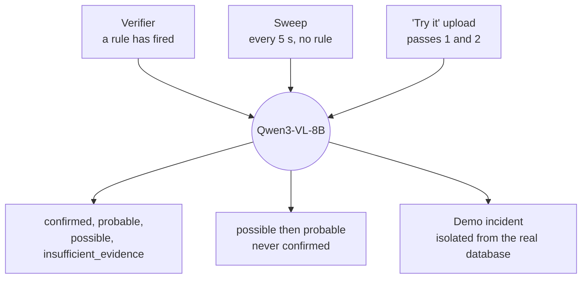
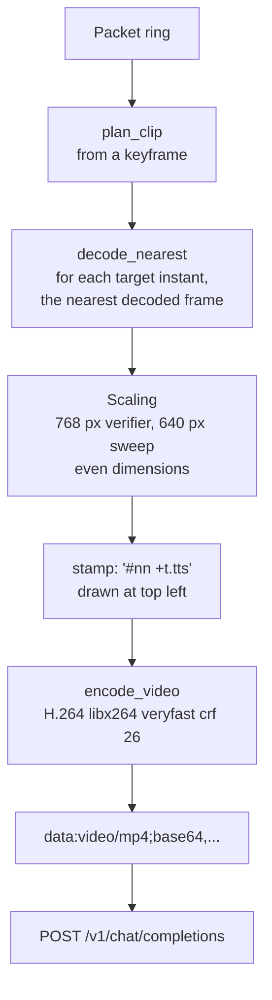
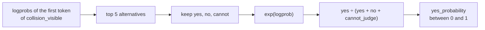
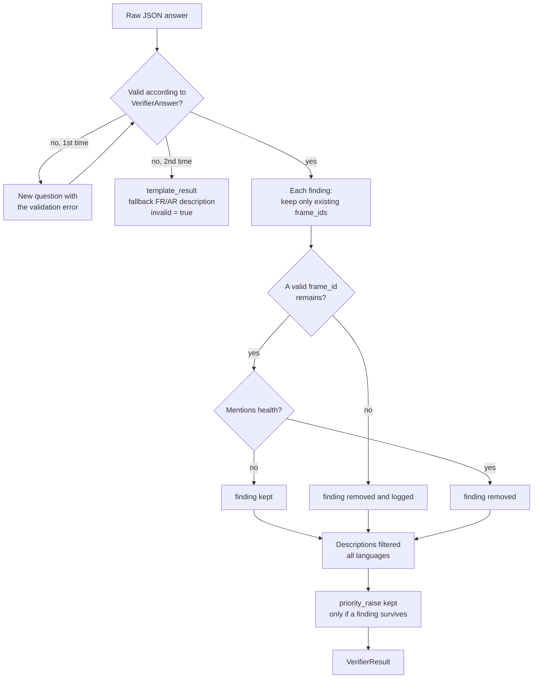
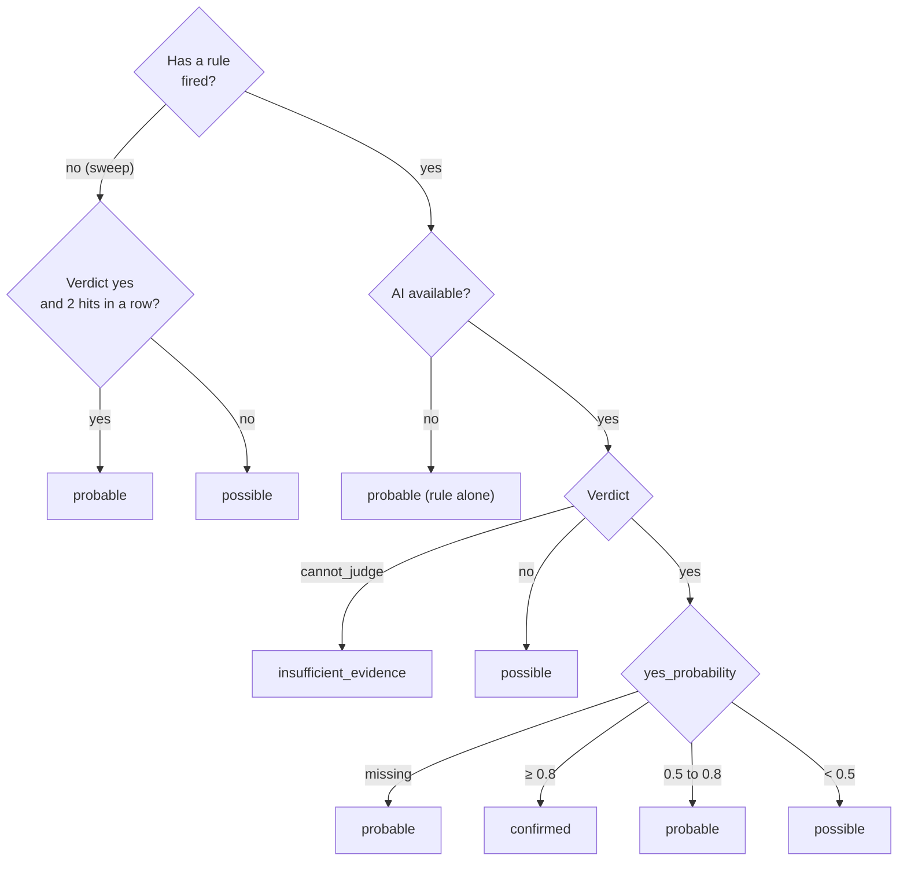
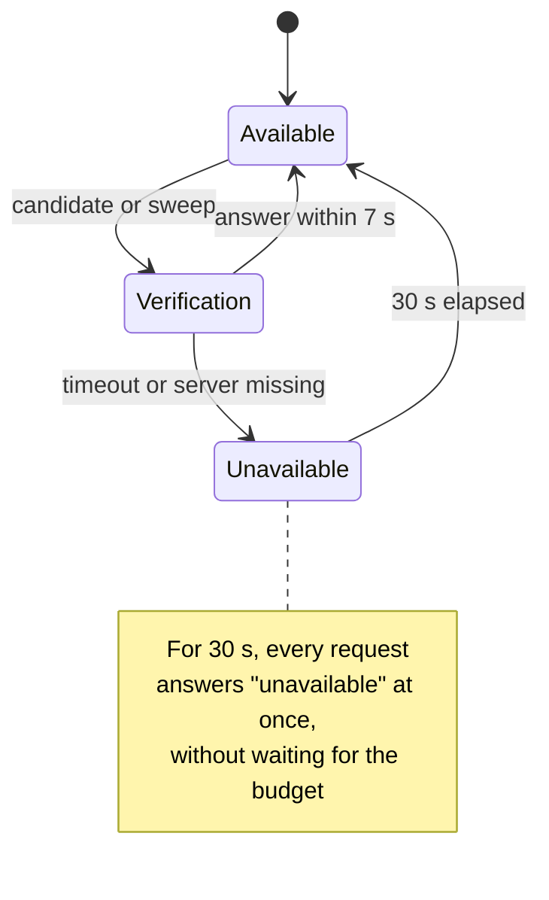
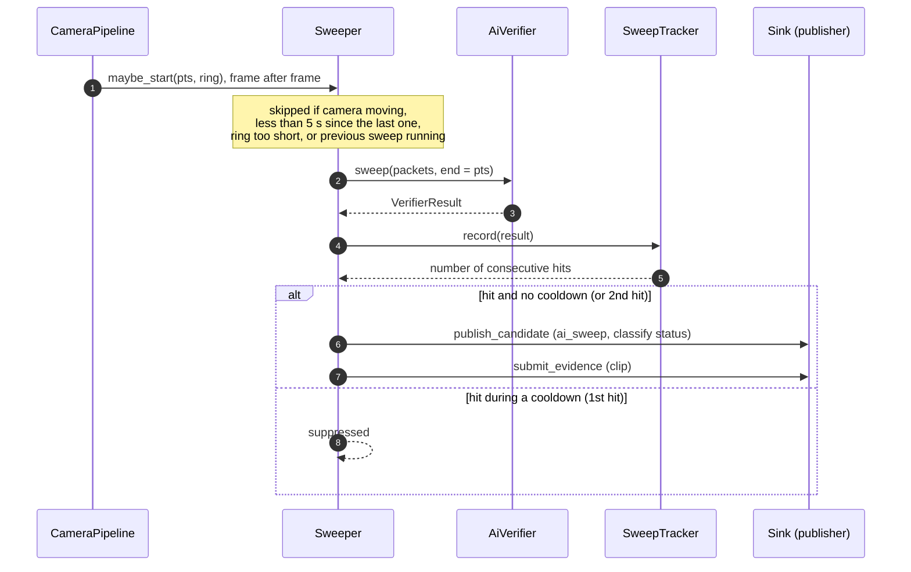

# 04 — Verification by the vision-language model (VLM)

> How Qwen3-VL-8B-Instruct-FP8 confirms or rejects a candidate, how its answer is checked, how its confidence is measured, and how the final status is decided. Code: `inference.py`, `verifier.py`, `clipvideo.py`, `verdict.py`, `safety.py`, `status.py`, `sweep.py`.

## 1. The model server (vLLM on Brev)

Defined in `deploy/gpu/compose.yml`.

| vLLM parameter | Value | Effect |
|---|---|---|
| Image | `vllm/vllm-openai:v0.11.2` | Qwen3-VL requires vLLM ≥ 0.11.0; version pinned |
| `--model` | `Qwen/Qwen3-VL-8B-Instruct-FP8` | 8-billion-parameter model, FP8 weights |
| `--max-model-len` | 8192 | Maximum context length |
| `--gpu-memory-utilization` | 0.75 | Leaves room for the RF-DETR workers on the same GPU |
| `--limit-mm-per-prompt` | `{"video":1,"image":0}` | One video per request, no images |
| `--enable-prefix-caching` | on | The fixed prompt is cached |
| `--mm-processor-cache-gb` | 0 | No multimodal preprocessing cache |
| `--max-num-seqs` | 8 | Up to 8 parallel requests |
| Port | `127.0.0.1:8000` | Instance loopback only |

The model is pinned by its **Hugging Face revision** (`9cdc6310…`) in `models.lock.yaml`, Apache-2.0 licence. The interface is OpenAI-compatible: `GET /v1/models` and `POST /v1/chat/completions`.

## 2. The three uses of the same model

| Use | Video input | Trigger | Possible statuses |
|---|---|---|---|
| **Verifier** (`verify_event`) | 16 dense frames at 4 fps (moment ± 2 s) + 4 context frames (−8 s, −5 s, −3 s, +4 s), 768 px | A rule has fired | All four |
| **Sweep** (`sweep`) | 16 frames: the last 8 seconds at 2 fps, 640 px | Every 5 s per camera | `possible`, then `probable` if twice in a row |
| **Scan** (`scan`, upload pass 1) | Up to 64 frames, 1 to 2 fps, 640 px, whole clip | A visitor uploads a video | See [05](05-try-it-yourself-mode.md) |

## 3. Building the video that is sent (`clipvideo.py`)

Details that matter:

- **Verifier instants** (`verifier_times`): 16 instants from `centre − 2 s` to `centre + 1.75 s` (0.25 s step), plus `centre − 8`, `−5`, `−3` and `+4 s`. Total: at most **20 frames**.
- **Sweep instants** (`sweep_times`): 16 instants, one every 0.5 s, over the last 8 seconds.
- **Never an invented frame**: if an instant does not exist (the future is not yet in the ring), the nearest existing frame is taken; duplicates are merged. The number of frames can therefore be below 20.
- **Number and time drawn on each frame** (`#07 -0.75s`) with a home-made 5×7 bitmap font (no OpenCV, testable). The model can thus cite **which frame** proves **what**, and place `t_contact` on the time scale.
- **A single video** rather than a list of images: about half the visual tokens (TD-01).
- Sent as a **base64 data URL**: works through the tunnel, with no shared volume or third-party hosting.
- No boxes or trails drawn on these frames: the winners of the CVPR 2026 ACCIDENT challenge observed they hurt (open question TQ-06).

## 4. The question: neutral (`NEUTRAL_PROMPT`)

The prompt does **not** say there is a crash. It describes the task and asks:

> Is a collision between road users visible? Answer `collision_visible` with `yes`, `no`, or `cannot_judge` (if the image is too dark, blurred or small); no collision is a valid answer.

It also asks for `t_contact`, the event type, the number of vehicles, blocked lanes, short findings citing frame numbers, what is **not assessable** (occupants, people behind intact windows, fuel leaks), a possible priority raise, and two short FR and AR descriptions. It explicitly forbids stating or guessing anyone's health or death.

Call settings (`BrevVlmClient._ask`): temperature **0**, `max_tokens` 700, **no thinking mode**, `logprobs: true` with `top_logprobs: 5`.

## 5. The answer: strict JSON (`verdict.py`)

The output is **schema-constrained** (`response_format: json_schema`, `VerifierAnswer` schema). The fields, in order:

| Field | Type | Meaning |
|---|---|---|
| `collision_visible` | `yes` / `no` / `cannot_judge` | **Written first**: its token is the decision whose probability is read |
| `t_contact` | number or null | Seconds on the stamp scale |
| `type` | `collision`, `rollover`, `fire`, `stalled`, `pedestrian`, `none` | What the model sees |
| `vehicles_involved`, `lanes_blocked` | integers ≥ 0 | |
| `findings[]` | `statement`, `basis` (`observed` / `inferred`), `frame_ids[]` | Cited findings |
| `not_assessable[]` | texts | What cannot be judged |
| `priority_raise` | 0 or 1 | Request for a priority raise |
| `description_fr`, `description_ar` | texts | Factual descriptions |

The schema forbids extra fields (`extra="forbid"`).

## 6. Confidence: a real probability (`yes_probability`)

Confidence is **not** a "I am 95 % sure" said by the model. It is the **probability of the "yes" token**, normalised over the three possible verdicts, read from the `top_logprobs` of the first decision token. If the decision token is absent from the 5 alternatives, the value is `None`, and a "yes" without a usable probability is **never** confirmed (see §8).

On the interface side, the exact value is never shown: `confidenceOf` (`apps/web/.../ai-confidence.ts`) buckets it into `high` (≥ 0.8), `medium` (≥ 0.5) or `low`.

## 7. The validation layer (`verdict.finalize`)

1. **Mandatory citation.** A finding keeps only the `frame_ids` between 0 and the number of frames actually sent. If none remains, it is removed and logged (FR-VIS-016).
2. **Nothing medical** (`safety.py`, FR-VIS-017). Word filter in **English, French and Arabic** (dead, deceased, injured, unconscious, bleeding, etc.). A finding or `not_assessable` item that mentions health is **removed, never rewritten**: replacing it with the neutral sentence "person on the ground" would amount to inventing an observation nobody made. The FR/AR **descriptions**, on the other hand, are cleaned sentence by sentence: an offending sentence is replaced by a neutral sentence in the requested language.
3. **A priority raise without a cited finding is ignored** (`priority_raise` forced to 0).
4. **One retry, then a fallback template.** An answer that does not respect the schema is asked again **once** with the list of errors. If it fails again, `template_result` produces an `invalid=True, available=False` result with a description such as "Automatic signal: sudden stop of a vehicle. Invalid AI visual analysis: human assessment needed." (FR and AR).
5. **Network failure or timeout**: immediate `available=False` result, **without retry**.

Quality counters (`VerifyStats`): valid answers, valid on the first try, invalid, unavailable, total and removed findings, `cannot_judge`.

## 8. From result to status (`status.py`)

| Rule? | VLM answer | Status |
|---|---|---|
| Yes | `yes`, P ≥ 0.8 | **confirmed** |
| Yes | `yes`, 0.5 ≤ P < 0.8 | probable |
| Yes | `yes`, P < 0.5 | possible |
| Yes | `yes`, P unknown | probable (never confirmed) |
| Yes | `no` | possible (both signals remain visible, flag `ai_contradicts_rule`) |
| Yes | `cannot_judge` | insufficient_evidence |
| Yes | AI unavailable or invalid | probable (rule alone) |
| No (sweep) | `yes` twice in a row | probable |
| No (sweep) | otherwise | possible |

The thresholds (`NADJET_STATUS_CONFIRMED = 0.8`, `NADJET_STATUS_PROBABLE = 0.5`) are **uncalibrated starting values** (TQ-07).

> **Point of attention.** The verifier asks the same question ("collision visible?") for **all** rules, including `stalled_vehicle` and `pedestrian_on_road`. A genuinely stalled vehicle is not a collision: the model may answer `no`, which yields `possible`. The evaluation harness already handles this case (`vetoed` in `evaluation.py`): for these two rules, the veto requires `no` **and** status `possible`. On the API side, these two incident types keep their own type (`stalled_vehicle`, `pedestrian_on_road`) whatever the status.

## 9. Time budget and fallback (`verifier.py`)

- A complete verification (building the video + call + a possible retry) is bounded by **`NADJET_VLM_BUDGET_S = 7`** (`asyncio.wait_for`).
- After a timeout or unreachable server, **`NADJET_VLM_BACKOFF_S = 30`**: the following candidates skip the AI immediately instead of each waiting 7 s.
- HTTP timeout of the call itself: `NADJET_VLM_TIMEOUT_S = 15`.
- The **first** health check (`vlm.check()`, which requires the served model to be the configured one) is only a warning at start-up: if it fails, candidates leave with rules alone.
- The candidate **always leaves** (FR-VIS-009).

## 10. The sweep (`sweep.py`)

- A **hit** = `collision_visible = yes` with probability ≥ `NADJET_SWEEP_YES_THRESHOLD` (0.5).
- First hit → `possible`. **Consecutive** second hit → `probable`. **Never** `confirmed`.
- Only one sweep at a time per camera: a sweep due while the previous one runs is skipped and counted (`skipped_busy`).
- **Cooldown**: a hit is suppressed if it falls within a rule's cooldown (120 s) or the sweep's own cooldown, **except** the second consecutive hit, the only one allowed through to improve the incident already created by the first.
- The sweep's `t_contact` is relative to the **end** of the window (negative values); if outside the window, the peak is the window end.
- The sweep is disabled with `NADJET_SWEEP_ENABLED=false`.

Justification (TD-22): rules alone reach about 71 % detection in the literature and have about twice the timing error of the VLM.

## 11. Why these model choices

| Choice | Reason |
|---|---|
| 8B in FP8 | Fits with RF-DETR on a single L40S GPU; the 32B brings little and does not fit next to the rest (TD-01) |
| No training | No Algerian crash data; no maintenance cost (PRD constraint C-02) |
| 4 fps rather than 10 | Found better by the winners of the CVPR 2026 ACCIDENT challenge |
| No thinking mode | It degraded temporal precision and slows things down |
| Apache-2.0 | Usable in an institutional product; a test fails if a non-permissive model is active by default |
| Single video | Half the visual tokens of an image list |

## 12. Reachability check

`nadjet-vision check-inference` (`make brev-check`) verifies that the endpoint answers and serves the configured model. On the API side, `GET /system/ai` (operator role) performs the same check and returns `available`, `model` and `detail` (never the host or a secret).
