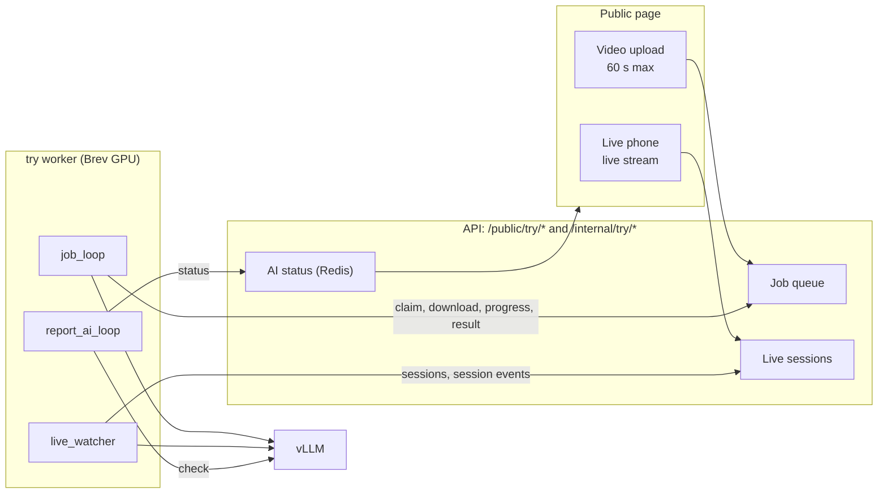
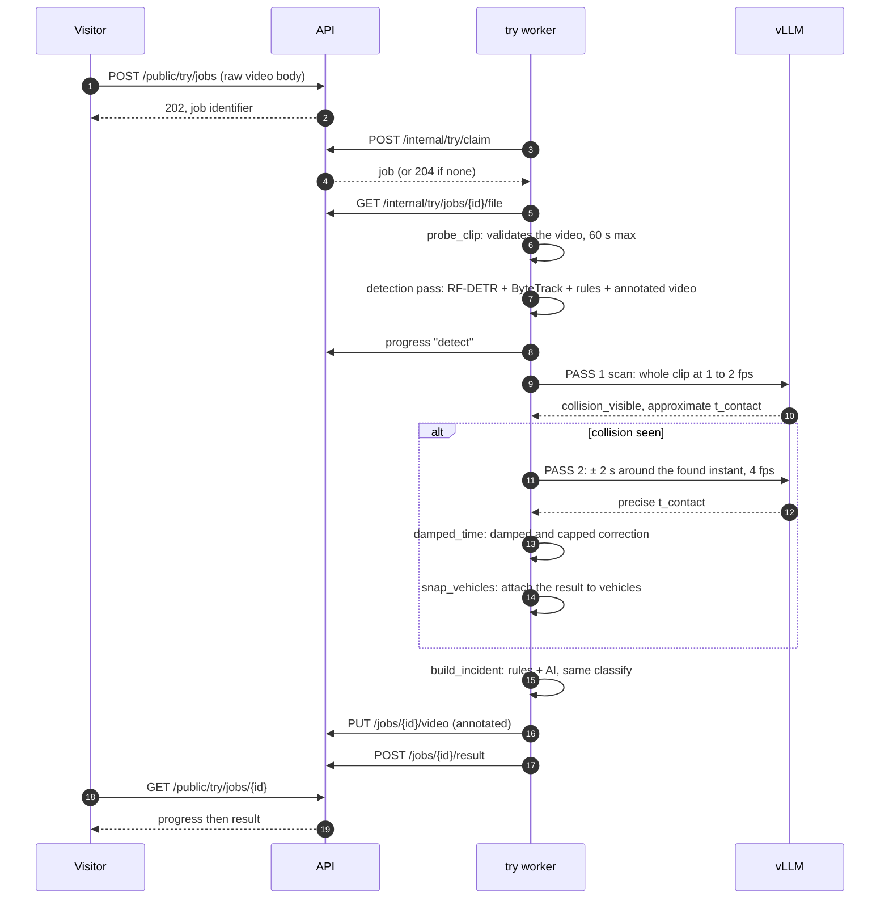
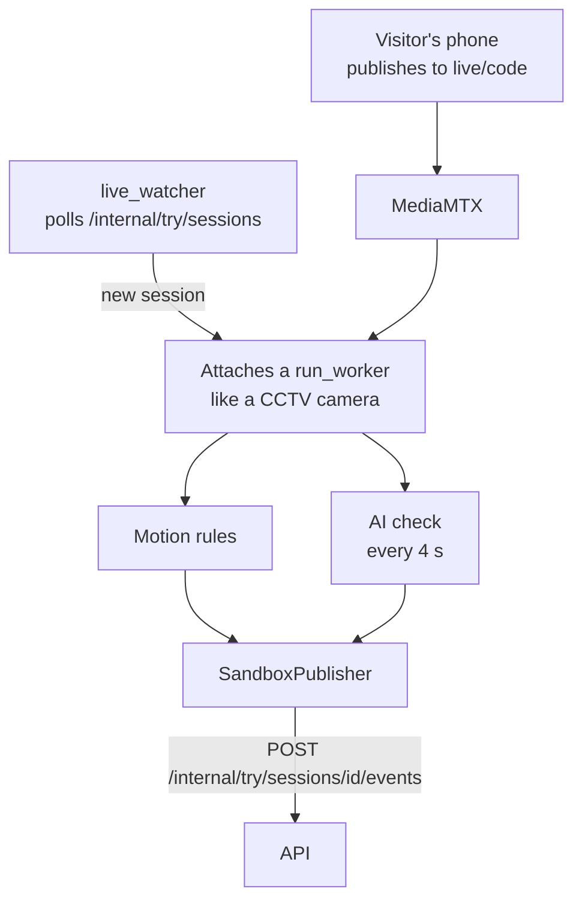

# 05 — The "Try it yourself" mode (sandbox)

> Lets a visitor (or the jury) test the AI with **their own video** or **their phone camera**, without touching real incidents. Requirements FR-CIT-002 to FR-CIT-005, decisions TD-23 and TD-40. Code: `services/vision/src/nadjet_vision/tryit.py` (worker), `services/api/src/nadjet_api/tryit/` (API).

## 1. Principle

The `nadjet-vision try` worker (a `try-worker` container in `deploy/gpu/compose.yml`) runs **the same pipeline** as the real cameras, with the same detector and the same vLLM server, but its results go to `/internal/try/*` and **never** to `/internal/candidates`. A sandbox incident is simply a field of a job's result: it never enters the operator's queue.

The worker runs three tasks in parallel: `job_loop` (uploaded videos), `live_watcher` (live phones) and `report_ai_loop` (every 10 s, it tells the API whether the AI answers, so the page can display "AI unavailable").

## 2. Uploaded video: two-pass analysis

### Rejecting a file (E-12)

`probe_clip` rejects without analysing: unreadable file, no video stream, duration > 60 s. A duration missing from the header (fragmented MP4, WebM) is checked on the decoded stream itself, so that a 2-hour file does not block the job loop. The job is then marked rejected with a message.

### Pass 1: the overview

- Video of the **whole clip**, **1 to 2 fps**, **64 frames maximum**, 640 px (`scan_times`, `build_scan_video`).
- The model answers `yes` / `no` / `cannot_judge` and gives an approximate `t_contact`, counted **from the start of the clip**.
- This pass is not bounded by the 7 s budget, only by the 15 s HTTP timeout.

### Pass 2: the zoom

- Started only if pass 1 sees a collision with a `t_contact`.
- Same verification as for a real camera (`verify_event`): 16 frames at 4 fps over ± 2 s around the found instant, plus 4 context frames.
- The final time is **damped**: `t = t_pass1 + 0.35 × (t_pass2 − t_pass1)`, the correction being **capped at ± 1.5 s** (`damped_time`).

This method comes from the three best papers of the ACCIDENT 2026 challenge.

### The detector's role here

RF-DETR **does not decide** whether there is a collision. It only serves to **attach the model's answer to vehicles**: `snap_vehicles` keeps the `N` vehicles closest to each other, `N` being the number of involved vehicles announced by the model (2 by default).

### Building the demo incident (`build_incident`)

It is the same status logic as for a real camera:

- A `confirmed` status (hence type `collision`) requires **a collision rule** (`collision_candidate` or `hard_stop`) **within 5 s** of the chosen instant, **and** a high-probability AI verdict.
- AI alone or rules alone never confirm: with no nearby rule, the cap is that of `classify` for an AI without a rule.
- The type is `collision` if `confirmed`, otherwise `possible_incident`.

### What the result contains (`TryResult`)

Duration, number of frames analysed, `ai_available`, the `scan` and `refine` results, `scan_t_s`, `event_t_s`, a **timeline** (`timeline`) mixing rule firings (`source = rule:<name>`) and AI verdicts (`source` = model identifier), the sandbox incident with its boxes, and the models used. Every AI value therefore carries its source (FR-VIS-021).

### If the AI is down

The rule-based analysis is still returned, with `ai_available = false`: the page says "AI unavailable" (FR-CIT-005).

## 3. Live phone

- The `live_watcher` polls the API every `NADJET_TRY_POLL_S` (1 s). For each listed session, it attaches a `run_worker` (the **same** one as for a camera) on `live/<code>`, with a fictitious camera `live-<code>`. When the session disappears, it detaches.
- The **sweep is set to `NADJET_LIVE_CHECK_S` = 4 s** for these sessions, and every check is reported (`ai_check`) whatever its verdict.
- `SandboxPublisher` replaces the incident publisher: it sends **session events** (`trigger`, `ai_check`) to the API, never a candidate, and **sends no evidence** (`submit_evidence` does nothing).
- The coordinates of these fictitious cameras are demo values, not displayed as a real place.

## 4. Sharing the detector

The `try` worker serves several jobs and sessions at the same time with **a single detector**: `LockedDetector` serialises calls with a lock. Each job or session creates its own tracker (`make_tracker`).

## 5. API side (`tryit/routes.py`, `tryit/internal.py`, TD-46)

| Topic | Behaviour |
|---|---|
| Upload | `POST /public/try/jobs` with the video as a **raw body** (`video/mp4`, `quicktime` or `webm`), no multipart: the size limit is applied while receiving, an oversized file stops early |
| Entry checks | Size (`NADJET_TRY_MAX_MB`, 100 MB), type detected by magic bytes (ISO BMFF `ftyp` or EBML), MP4/MOV duration read from `moov/mvhd` (> 60 s: 422). WebM duration is checked by the worker (job rejected) |
| Rate limiting | Per IP: 5 uploads/min, 5 live sessions/min, 30 progress streams/min. Global caps on open jobs and live sessions (503 response) |
| Status | `GET /public/try/status`: limits (`max_seconds`, `max_mb`, `ttl_s`) and AI availability |
| Progress | SSE stream fed by the job row (re-read every 0.5 s), which lives 120 s and which the browser reopens |
| Storage | `try_jobs` and `try_sessions` tables **with no foreign key** to `incidents`, plus a `NADJET_TRY_DIR` folder: the operator queue, KPIs and evaluation cannot see them |
| Purge | Every 60 s in the API: deletion of jobs, files and sessions after the TTL (1 h), failure of jobs abandoned by a worker (5 min), end of sessions whose phone stopped answering (30 s) |
| Job claim | The worker claims a job with `SELECT … FOR UPDATE SKIP LOCKED` |
| Phone | WHIP publishing to `live/<id>` (MediaMTX); `GET /cameras` lists active sessions with `live_demo: true`; `<path>_ai` carries the boxes |

## 6. Why an isolated sandbox

- A visitor must **never** be able to create a fake incident in the real queue.
- Uploaded clips are external data, often without redistribution licence.
- The jury can test **its own video**, which proves the system is not tuned for known clips (integrity FR-VIS-020 to 022, see [07](07-safeguards-and-limits.md)).
