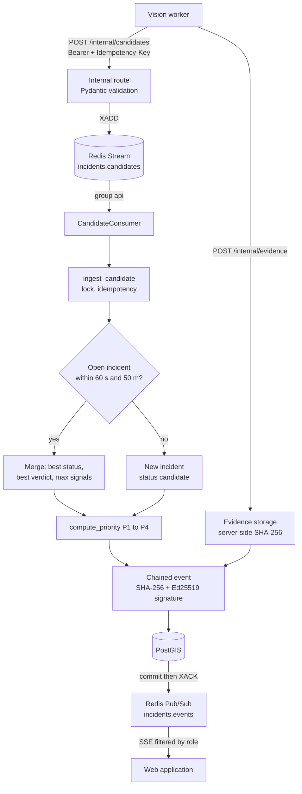
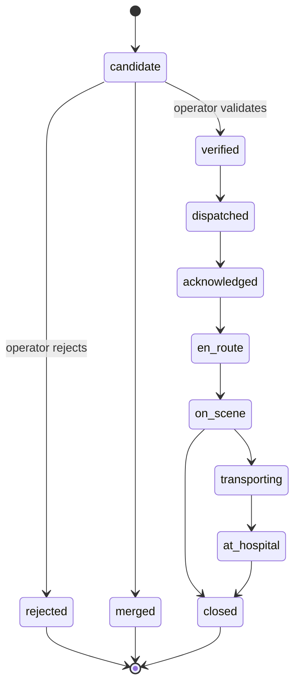
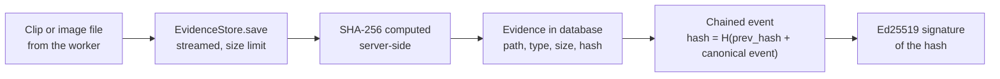

# 06 — Integration into the API: from the AI to the incident

> What happens to a candidate once the worker has posted it: Redis queue, incident creation or merge, priority computation, signed evidence, real time and display. Code: `services/api/src/nadjet_api/incidents/`, `packages/shared/`, `apps/web/`.

## 1. Overview

## 2. Reception and Redis queue (`internal.py`, `ingest.py`)

- `POST /internal/candidates` requires a **service token** (`Authorization: Bearer`, `require_ingest_token`) and an `Idempotency-Key` header (1 to 128 characters). The body is validated against `IncidentCandidate`. Response: **202 Accepted** with the Stream entry identifier.
- The API only **appends** to the Redis Stream `incidents.candidates` (`XADD`). It does not touch the database at that moment: the response is therefore fast.
- The `CandidateConsumer` (group `api`) persists each entry and **acknowledges it (`XACK`) only after the database commit** (NFR-REL-002: no candidate lost).

| Case | Behaviour |
|---|---|
| Malformed entry | Sent immediately to `incidents.candidates.dead` |
| Persistence failure | Stays pending, redelivered; after **10 deliveries**: `incidents.candidates.dead` |
| Consumer stopped mid-entry | Entries idle for **30 s** are reclaimed (`XAUTOCLAIM`) |
| Redis cut or group deleted | The loop logs, recreates the group and retries |
| Same key redelivered | `ingest_candidate` returns the incident already created: no duplicate |

## 3. Creation or merge (`service.ingest_candidate`)

A **PostgreSQL advisory lock** (`pg_advisory_xact_lock`) serialises creation: two simultaneous candidates do not create two incidents, and a retry sees the first commit rather than a uniqueness violation.

### Merge (`merge.py`)

A candidate is **merged** into an open incident if, at the same time:

- the `event_time` gap is **≤ 60 s**;
- the distance (PostGIS, `ST_DWithin` on geography) is **≤ 50 m**.

On merge:

| Field | Rule |
|---|---|
| `report_count` | +1 |
| `last_event_time` | The most recent |
| `ai_signals` | The **maximum** value of each signal (`merge_signals`) |
| `verifier_result` | The available verdict, then the highest `yes_probability` (`best_verifier`) |
| `ai_status` | The best rank: insufficient_evidence < possible < probable < confirmed (`best_ai_status`) |
| Type | If the incident becomes `confirmed` while it was `possible_incident`, it becomes `collision` |
| Witness | `trapped_reported` as logical OR, `people_reported` as maximum |
| Priority | Recomputed |

This merge is what cleanly gathers the `hard_stop` and the `collision_candidate` of the same crash, as well as the first and second sweep hits.

### Incident type

`incident_type()`: a `stalled_vehicle` trigger gives `stalled_vehicle`, `pedestrian_on_road` gives `pedestrian_on_road`. For the others, the type is **`collision` only if the AI status is `confirmed`**, otherwise **`possible_incident`**. A rule or an AI alone therefore never makes a collision (FR-VIS-007).

## 4. Explainable priority P1 to P4 (`priority.py`)

Pure function. **P1 is the most urgent.** Each observed rule imposes a minimum level; the final priority is the most urgent of the minimums.

| Rule | Level | Who supplies the signal |
|---|---|---|
| Bus involved (`bus_involved`) | 1 | Vision or operator |
| Person on the carriageway (`person_on_road`) | 1 | Vision or operator |
| Flames (`flames`) | 1 | Operator (manual entry) |
| Person trapped (`trapped`) | 1 | Witness or operator |
| ≥ 3 vehicles (`vehicle_count`) | 2 | Operator (vision sends 1 or 2) |
| Overturned vehicle (`overturned`) | 2 | Operator |
| Smoke (`smoke`) | 2 | Operator |
| To assess (`to_assess`) | 2 | Automatic: no rule, or `insufficient_evidence` |
| Vehicle stopped in a live lane (`stopped_in_lane`) | 3 | Vision or operator |
| Two-vehicle collision | 3 | Vision |
| Vehicle stopped off the lane (`stopped_off_lane`) | 4 | Not emitted today |

> The vision workers currently only emit `bus_involved`, `person_on_road`, `vehicle_count` (1 or 2) and `stopped_in_lane`. The signals `flames`, `smoke`, `overturned`, `night`, `highway` and `stopped_off_lane` are read by the priority computation but produced by no vision code in the repository: only `flames`, `smoke` and `overturned` can be entered by an operator during manual creation (`POST /incidents`). A fire/smoke detection module is planned as an option, disabled by default.

Modulations:

- **Context**: `night` or `highway` raises by **one** level (signals read but not yet produced, see above).
- **AI raise** (`ai_raise`): only if the verdict is available, `priority_raise > 0`, at least one finding **cites frames**, and no context raise has already happened. At most **one** level in total (context + AI). The AI never **lowers**.
- **Triage**: as soon as there are triaged casualties, it replaces the AI raise and the context.
- Quality flags: `ai_unavailable`, `insufficient_evidence`, `ai_contradicts_rule` (rule yes, AI no).
- `mass_casualty`: bus involved, or ≥ 5 victims. `needs_extrication`: a witness reports a trapped person.

Each reason carries its **source** (rule name, or model identifier for an AI raise), in line with FR-VIS-021: every displayed AI value shows where it comes from.

## 5. Lifecycle (`lifecycle.py`)

An AI-originated candidate stays in `candidate` status until **an operator has validated it** (`POST /incidents/{id}/verify`) or rejected it (`reject`, with a reason: false positive, duplicate, not an emergency, other). **The AI never sends anyone out on its own.** Incidents created by hand by an operator (phone call) are born already `verified` and without AI status (`ai_applicable=False`).

## 6. Evidence and integrity (`evidence.py`, `signing.py`, `service.append_event`)

- Accepted types: clip `video/mp4` or `video/webm`, image `image/jpeg` or `image/png`. Otherwise **415**. Too large: **413**. Candidate not yet saved: **409** (the worker retries).
- The incident is identified by `incident_id` or by the candidate's `idempotency_key`.
- Each incident event (creation, merge, evidence, state change) is appended to a **hash chain**: `hash = chain_hash(prev_hash, sorted canonical JSON event)`, then signed with **Ed25519** (`ChainSigner`). Modifying a past event breaks the chain.
- `GET /incidents/{id}/integrity` lets you verify this chain.

## 7. Real time (`events.py`)

After each commit, the API publishes a minimal message on the Redis channel `incidents.events`: **identifiers only** (`incident_id`, `version`, agencies, facilities). Clients then reopen the incident: the database remains the truth, the message is "best effort".

The **SSE** stream (`GET /events`) filters each message by the **role's scope** (`visible_to`): an operator sees everything, an agency sees only its incidents, a hospital only its own. A 15 s heartbeat keeps the connection open. Types: `incident.created`, `incident.updated`, `incident.status_changed`, `camera_fault`, `camera_recovered`, `facility.updated`.

## 8. Web display

| Element | File | Behaviour |
|---|---|---|
| AI status | `components/incident/ai-status.tsx` | Status label + "uncertain" marker (icon **and** text, never colour alone) |
| Uncertain? | `ai-confidence.ts` (`isUncertain`) | True if `possible`, `insufficient_evidence`, AI unavailable or `cannot_judge` (NFR-SAFE-001) |
| Confidence | `ai-confidence.ts` (`confidenceOf`) | Three tiers `high` ≥ 0.8, `medium` ≥ 0.5, `low`; the exact value is never shown |
| Pages | `pages/ops/incident/*`, `pages/respond/respond-detail.tsx`, `pages/public/try-page.tsx` | Operator, responder, public |
| Texts | `locales/fr.json`, `ar.json`, `en.json` | Trilingual interface |

Repository rule: the test policy forbids any frontend test; the web app is validated by `make typecheck`, `make lint` and `pnpm build`. API calls go only through `@nadjet/api-client`, generated from `contracts/openapi.json`.

## 9. Other AI-related endpoints

| Endpoint | Role |
|---|---|
| `GET /system/ai` | AI server status for the operator (available, model, detail without secrets) |
| `GET /evaluation/latest` | Latest evaluation results file (supervisor and admin roles; 404 if none) |
| `POST /internal/camera-health` | Worker health reports |
| `/public/try/*` and `/internal/try/*` | Sandbox ([05](05-try-it-yourself-mode.md)) |
