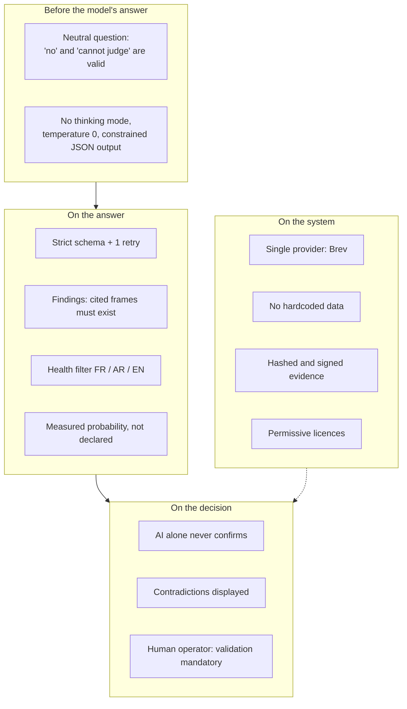
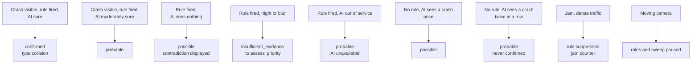

# 07 — Safeguards, integrity and limits

> What makes Nadjet's AI reliable, what is checked automatically, and above all **what is not yet measured**. To read before any presentation.

## 1. The safeguards

| Safeguard | What it does | Where / requirement |
|---|---|---|
| **AI alone never confirms** | `confirmed` requires a fired rule **and** P(yes) ≥ 0.8. The sweep caps at `probable` | `status.py`, FR-VIS-007 |
| **Neutral question** | "Collision visible?" with `no` and `cannot_judge` as legitimate answers | `inference.py` |
| **Mandatory citation** | Each finding cites frame numbers that exist, otherwise it is removed and logged | `verdict.py`, FR-VIS-016 |
| **Observed or inferred** | Each finding is marked `observed` or `inferred` | `FindingAnswer` |
| **Nothing medical** | Findings that talk about health are **removed**, descriptions are cleaned sentence by sentence, in AR/FR/EN. What the AI cannot see goes into `not_assessable` | `safety.py`, FR-VIS-017 |
| **Validated output + 1 retry** | Invalid JSON: new attempt with the error; still invalid: fallback description from the rule | `verdict.template_result`, TD-24 |
| **Fallback without blocking** | AI slow (> 7 s) or absent: the candidate leaves with rules alone, status `probable` | `verifier.py`, FR-VIS-009 |
| **Visible contradictions** | Rule yes and AI no: status `possible` and flag `ai_contradicts_rule` | `status.py`, `priority.py` |
| **Source displayed** | Every AI value carries its rule or model (`source`, `model`) | FR-VIS-021 |
| **Bounded priority raise** | The AI can raise by **one** level at most, never lower, and only with a finding that cites frames | `priority.py` |
| **Human validation** | A candidate stays `candidate` until an operator has validated it | `lifecycle.py`, FR-INC-005 |
| **Single AI provider** | Brev only; unauthorised host refused; no fallback | `inference.py`, TD-27 |
| **No fake data** | No incident, detection or confidence from hardcoded data, a file name, a timestamp or randomness. Mocks allowed **only in tests** | `scripts/check-integrity.sh`, FR-VIS-020 |
| **No tuning on the demo** | Demo clips come from `eval/heldout.json`, never used for tuning | FR-VIS-022 |
| **Tamper-proof evidence** | Stream-copy clip, SHA-256, event chain, Ed25519 signature | TD-16, TD-33 |
| **Verified weights** | SHA-256 of the detector, Hugging Face revision of the VLM | `models.lock.yaml`, TD-25 |
| **Clean licences** | Apache-2.0 models; a test fails if a non-permissive model is active by default | `models.py`, NFR-LIC-001 |
| **No lost candidate** | Redis Streams, acknowledgement after commit, dead letter | `ingest.py`, NFR-REL-002 |

## 2. The repository's integrity rules

Imposed by `AGENTS.md` and checked by `scripts/check-integrity.sh` in CI:

1. **Never** an incident, detection or confidence value coming from hardcoded data, timestamps, file names or randomness.
2. **Simulated AI answers** exist only in tests.
3. **Demo clips** come from the held-out list `eval/heldout.json` and are **never** used for tuning. Only the catalogue validators and `eval/run_eval.py` may read it.
4. No call to another AI provider (OpenAI, Gemini, Anthropic API, build.nvidia.com, Ollama, local MLX, etc.).
5. Never create, start, stop or delete a Brev instance without explicit approval: credits are shared.

## 3. Behaviour by scenario

## 4. Known limits (say them before you are asked)

### What is not measured

| Topic | State | Reference |
|---|---|---|
| **Detection and false-alarm rates** | No result: `eval/results/` is empty. Do not quote any percentage until `make eval` has produced a file | TD-42, SC-004, SC-005 |
| **VLM latency** (p50, p95) | Not measured. The 7 s is a constraint, not a measurement. If the sweep p95 exceeds 6 s: sweep every 8 to 10 s, or Qwen3-VL-4B for the sweep only | TQ-02 |
| **0.8 / 0.5 / 0.5 thresholds** | Starting values not calibrated on non-demo clips | TQ-07 |
| **Do the 20 frames reach the model?** | To be verified: vLLM may subsample the video (check `prompt_tokens`). Also `--max-model-len 8192` is a bound to confirm on real requests | TD-41 |
| **Real GPU cost** | July 2026 estimate to recheck in the Brev console | doc 10 |

### Design limits

- **Relative speed only.** No km/h: it would require calibrating each camera.
- **The rules miss** rollovers and single vehicles against an obstacle. Only the sweep covers them, so they are capped at `probable`.
- **The verifier always asks the "collision?" question**, even for a stalled vehicle or a pedestrian: a legitimate "no" can degrade the status of these incidents (see [04](04-vlm-verification.md) §8).
- **The model cannot see the occupants' condition**: it does not say it, and that is intentional (`not_assessable`).
- **Dependence on a single GPU instance.** If Brev goes down, the AI is declared unavailable; the rules continue.
- **Priority signals not produced by vision**: `flames`, `smoke`, `overturned`, `night`, `highway`, `stopped_off_lane` are emitted by no current vision code ([06](06-api-integration.md) §4).
- **Fire/smoke detection**: optional module, AGPL-derived, separate process, disabled by default in production.
- **5 frames/s analysis rate**: sufficient to track a vehicle, not for very fast collisions between two frames.
- **Boxes drawn on the verifier's frames**: not implemented (TQ-06); the corresponding ablation row is marked "not run".
- **No evaluation on annotated Algerian clips** as long as the impact annotations of the "crash" clips are pending (`annotation_status: pending` in `eval/heldout.json`).

## 5. Likely questions and short answers

| Question | Answer |
|---|---|
| Why not a single big model? | Too slow and costly continuously. The rules filter cheaply, the VLM decides a few times. |
| Why not train your own model? | No Algerian crash data, and pre-trained models reach the state of the art on this kind of task. |
| What if the AI hallucinates? | Mandatory cited frames, health filter, validated JSON, neutral question, human validation. |
| What if the AI goes down? | The incident leaves with rules alone, flagged as such. Nothing is blocked or lost. |
| How do you know it works? | Reproducible evaluation with ablations and held-out clips. (Quote figures only after `make eval`.) |
| Do jams create false alarms? | "Jam" normalisation: alert suppressed if ≥ 30 % of the other vehicles slow down. |
| Does data leave the country? | No: inference on our Brev instance, a single provider, no third-party API. |
| Can a displayed figure be trusted? | Every AI value shows its source; nothing is hardcoded, checked in CI. |
| Can the jury test it? | Yes, with the "Try it yourself" mode: their own video, isolated from the real database. |
