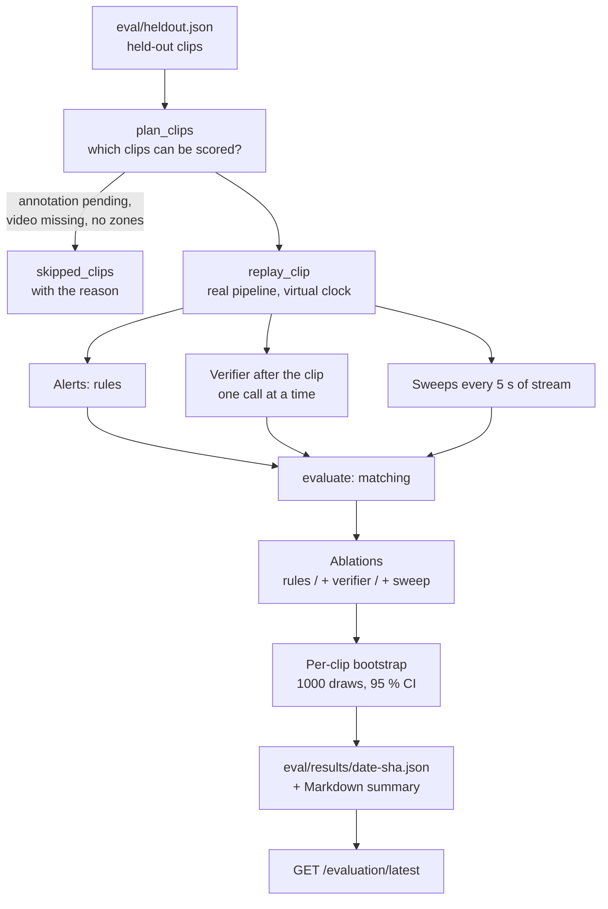
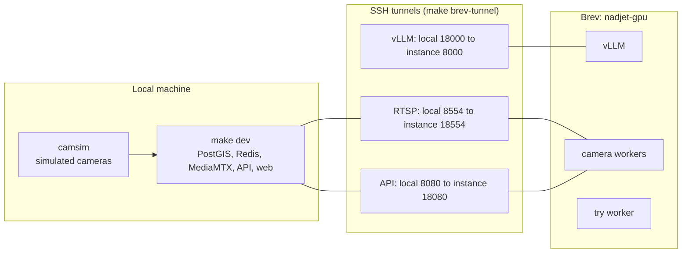

# 08 — Evaluation, deployment and configuration

> How to measure the AI, how to launch it on the Brev GPU, and the list of configuration variables. Code: `eval/run_eval.py`, `services/vision/src/nadjet_vision/evaluation.py`, `replay.py`, `scripts/brev.sh`, `deploy/gpu/compose.yml`, `Makefile`.

## 1. Reproducible evaluation (`make eval`)

### Principle

The harness replays **held-out** clips (`eval/heldout.json`) in the **real** `CameraPipeline` (same detector, tracker and rules as in production), then queries the verifier and the sweep on the same ring copies as the real worker.

### Counting rules (TD-42)

- The time of an alert is `t_fire` (when it is raised); the impact estimate is `t_peak`.
- **Crash clip**: a true positive if a `collision_candidate`, `hard_stop` or sweep alert falls in **[impact − 2 s, impact + 10 s]** (the first one is counted). Subsequent crash alerts in the window are **duplicates** (the API merges them): neither true nor false positives. Outside the window or another trigger: false positive. No alert: false negative.
- **Stalled vehicle clip**: no impact instant, any `stalled_vehicle` alert is a true positive.
- **Normal or jam clips**: any alert is a false alarm, reported per **camera-hour**.

### The three compared configurations (ablations)

| Configuration | What counts |
|---|---|
| `rules` | All rule alerts, the AI ignored |
| `rules+verifier` | Rule alerts, **vetoed** if the verifier sees "no collision" (for stalled and pedestrian: `no` **and** status `possible`). An unavailable verifier never vetoes |
| `rules+verifier+sweep` | Verified alerts plus those of the sweep |

### Metrics produced

Precision, recall, F1, detection delay, error on the impact instant, false alarms per camera-hour, verifier and sweep latencies (percentiles), and AI quality metrics (valid on first try, `cannot_judge`, removed findings), with **Wilson** intervals for proportions.

### Harness safeguards

| Exit code | Case |
|---|---|
| 3 | A tuning file (`data/tuning`, `.env*`, `eval/tuning`) cites an evaluation clip, or a camera with threshold overrides is bound to an evaluation clip: **tuning on held-out clips is refused** |
| 4 | Brev does not answer (without `--no-ai`): **no silent fallback** |

Options: `--no-ai` (rules alone, no Brev), `--camera` (camera whose zones score clips without a camera), `--samples`, `--seed`, `--out`, `--compare A B`.

### Comparing two runs

`make eval-compare A=a.json B=b.json`: two runs are reproducible when each metric of one falls within the other's interval. The draw is seeded (`seed`), so re-running on the same results gives the same interval.

> Current state: `eval/results/` is empty. The "crash" clips of `heldout.json` have `annotation_status: pending`, so they are listed in `skipped_clips` until their impact instant is annotated.

## 2. Deployment on NVIDIA Brev

### Topology

### Steps

| Step | Command | Effect |
|---|---|---|
| 1 | `brev login` then `brev ls` | Join the organisation and see `nadjet-gpu` |
| 2 | `brev start nadjet-gpu` | **Only if the instance is STOPPED.** Spends shared credits (~$1.74/h): get the team's agreement |
| 3 | `make brev-up` | Starts vLLM on the instance and waits for the model to load (~2 min) |
| 4 | `make brev-forward` | Opens `localhost:18000` to `instance:8000` |
| 5 | `make brev-check` | Must print: `OK … serves Qwen/Qwen3-VL-8B-Instruct-FP8` |
| 6 | `make dev` (locally) | Infra, API, cameras (`make camsim` first) |
| 7 | `make brev-tunnel` | Opens the three tunnels |
| 8 | `make brev-deploy-workers` | Pulls (or builds) `ghcr.io/nadjeet/nadjet-vision:dev` and starts the workers |
| 9 | `make brev-logs F=-f` | Follows the logs: `camera=… fps=…` |
| 10 | `make brev-untunnel` then `brev stop nadjet-gpu` | Closes the tunnels, **stops billing** |

Rules: never leave the instance running without use, never run `brev create` or `brev delete`, tell the team when starting and stopping, never print a token.

### Docker services (`deploy/gpu/compose.yml`)

| Service | Profile | Role |
|---|---|---|
| `vllm` | always | VLM server; `healthcheck` on `/v1/models` (120 s start period, 60 retries) |
| `workers` | `workers` | `nadjet-vision camera --all`, host network to reach the tunnels, GPU `compute,utility,video`; starts after `vllm` is healthy |
| `try-worker` | `workers` | `nadjet-vision try` (sandbox) |

Volumes: `hf-cache` (Hugging Face weights), `weights` (detector weights, verified). The `services/vision/Dockerfile` image starts from `nvidia/cuda:12.4.1-runtime`, installs ffmpeg and runs the application as an unprivileged user (uid 10001).

### Worker commands (`cli.py`)

| Command | Effect |
|---|---|
| `nadjet-vision check-inference` | Checks the Brev endpoint and the served model |
| `nadjet-vision camera --all` | Supervisor: one process per catalogue camera |
| `nadjet-vision camera --id <id> [--inline] [--metrics-port N] [--duration S]` | One or more cameras; `--inline` = a single process without supervisor |
| `nadjet-vision try [--duration S]` | Sandbox worker |

## 3. Configuration variables (`NADJET_*`)

Defined in `VisionSettings` (`config.py`) and documented in `.env.example`.

### Model and inference

| Variable | Default | Role |
|---|---|---|
| `NADJET_BREV_INSTANCE` | `nadjet-gpu` | Brev instance name |
| `NADJET_VLM_BASE_URL` | `http://127.0.0.1:18000/v1` | vLLM endpoint (loopback or allowed host) |
| `NADJET_VLM_MODEL` | `Qwen/Qwen3-VL-8B-Instruct-FP8` | Expected model |
| `NADJET_VLM_ALLOWED_HOSTS` | empty | Additional allowed Brev hosts |
| `NADJET_VLM_TIMEOUT_S` | 15 | HTTP timeout of a call |
| `NADJET_VLM_BUDGET_S` | 7 | Budget of a complete verification |
| `NADJET_VLM_BACKOFF_S` | 30 | Duration without AI after a failure |

### Video and detection

| Variable | Default | Role |
|---|---|---|
| `NADJET_RTSP_BASE` | `rtsp://127.0.0.1:8554` | Stream base (`<base>/<camera id>`) |
| `NADJET_DETECTOR_MODEL` | `rf-detr-medium` | Entry of `models.lock.yaml` |
| `NADJET_DETECTOR_THRESHOLD` | 0.4 | Minimum confidence of a detection |
| `NADJET_SAMPLE_FPS` | 5 | Frames analysed per second |
| `NADJET_EVIDENCE_BUFFER_S` | 20 | Size of the packet ring |
| `NADJET_EVIDENCE_BEFORE_S` / `AFTER_S` | 10 / 5 | Clip before and after the peak |
| `NADJET_EVIDENCE_KEYFRAMES` | 6 | JPEG images per clip |
| `NADJET_ANNOTATE` | true | Publish the `<camera>_ai` stream |
| `NADJET_ANNOTATED_ENCODER` | `h264_nvenc` | ffmpeg encoder |
| `NADJET_STALL_S` | 10 | Silence meaning camera fault |

### Rules, sweep and status

| Variable | Default | Role |
|---|---|---|
| `NADJET_TRIGGER_COOLDOWN_S` | 120 | Delay between two alerts of a camera |
| `NADJET_VERIFY_CANDIDATES` | true | Have candidates verified by the AI |
| `NADJET_SWEEP_ENABLED` | true | Enable the sweep |
| `NADJET_SWEEP_EVERY_S` | 5 | Sweep interval |
| `NADJET_SWEEP_YES_THRESHOLD` | 0.5 | P(yes) counting as a sweep hit |
| `NADJET_STATUS_CONFIRMED` | 0.8 | `confirmed` threshold |
| `NADJET_STATUS_PROBABLE` | 0.5 | `probable` threshold |
| `NADJET_PUBLISH_CANDIDATES` | true | Send candidates and evidence to the API |

### API link, health, sandbox

| Variable | Default | Role |
|---|---|---|
| `NADJET_API_URL` | `http://127.0.0.1:8080` | Coordination API |
| `NADJET_INGEST_TOKEN` | none | Service token for `/internal/*` (never logged) |
| `NADJET_CAMERAS_FILE` | `data/cameras.yaml` | Camera catalogue |
| `NADJET_MODELS_LOCK` / `NADJET_WEIGHTS_DIR` | `models.lock.yaml` / `weights` | Pinned models and downloaded weights |
| `NADJET_METRICS_PORT_BASE` | 9100 | Camera *i* serves `/metrics` on base + i |
| `NADJET_HEALTH_PUSH_S` | 5 | Health report interval |
| `NADJET_LIVE_CHECK_S` | 4 | AI check of live phones |
| `NADJET_TRY_POLL_S` | 1 | Polling of jobs and sessions |

On the API side, the sandbox limits have their own variables (`NADJET_TRY_MAX_MB`, `TRY_MAX_SECONDS`, `TRY_TTL_S`, `TRY_JOBS_PER_MINUTE`, etc., see [05](05-try-it-yourself-mode.md)).

## 4. Model pinning (`models.lock.yaml`)

| Model | Role | Pinning | Licence |
|---|---|---|---|
| `rf-detr-medium` | Detector (default) | `rfdetr==1.11.2`; SHA-256 `749ff607…768c8` of the weight file `rf-detr-medium.pth` | Apache-2.0 |
| `qwen3-vl-8b-instruct-fp8` | Verifier and sweep (default) | Image `vllm/vllm-openai:v0.11.2`; Hugging Face revision `9cdc6310…2aee45` | Apache-2.0 |

Loading: a downloaded weight needs `filename` and `sha256`; a model served by vLLM needs a `revision`. Download goes to a `.part` file verified before being renamed. A test fails if a model active by default does not have a permissive licence (`Apache-2.0`, `MIT`, `BSD-2-Clause`, `BSD-3-Clause`).

## 5. Tests

| Type | Where | Particularities |
|---|---|---|
| Vision unit | `services/vision/tests/` (≈ 25 files) | Fake detectors, fake publishers, `httpx.MockTransport`; no network, no GPU |
| API unit | `services/api/tests/test_*_unit.py`, `test_incidents_priority.py`, `test_incidents_pure.py`, `test_system_ai_unit.py`, `test_try_unit.py` | |
| Integration | `@pytest.mark.integration` | Real PostGIS and Redis (`make infra`); **fail, do not skip**, if infra is absent |
| Live Brev | `@pytest.mark.brev`, `test_integration_brev.py` | Never in CI; `make test-brev`; spends credits |
| Frontend | None | Strict policy: validation by `make typecheck`, `make lint`, `pnpm build` |

Definition of "done": `make format && make lint && make typecheck && make check-contracts && make test` must all pass locally.

## 6. Quick troubleshooting

| Symptom | Lead |
|---|---|
| `FAIL … not usable` on `check-inference` | Instance stopped, or `make brev-forward` not launched |
| `Brev vLLM serves [...], expected '...'` | The served model differs from `NADJET_VLM_MODEL` |
| `AI endpoint host '…' is not loopback or an allowed Brev host` | Use `make brev-forward` or add the host to `NADJET_VLM_ALLOWED_HOSTS` |
| `NADJET_INGEST_TOKEN is not set` | Candidates and health are not published; set the token |
| `checksum mismatch` | Detector weights altered or incomplete; delete the file from `weights/` |
| Candidates always `probable` with "AI unavailable" | The verifier is in its 30 s fallback period, or vLLM is overloaded (> 7 s) |
| Annotated stream missing | ffmpeg or NVENC failure: the `libx264` fallback applies; check the logs |
| `camera_fault` | No frame for 10 s: stream cut (`disconnect`) or frozen (`stall`) |
