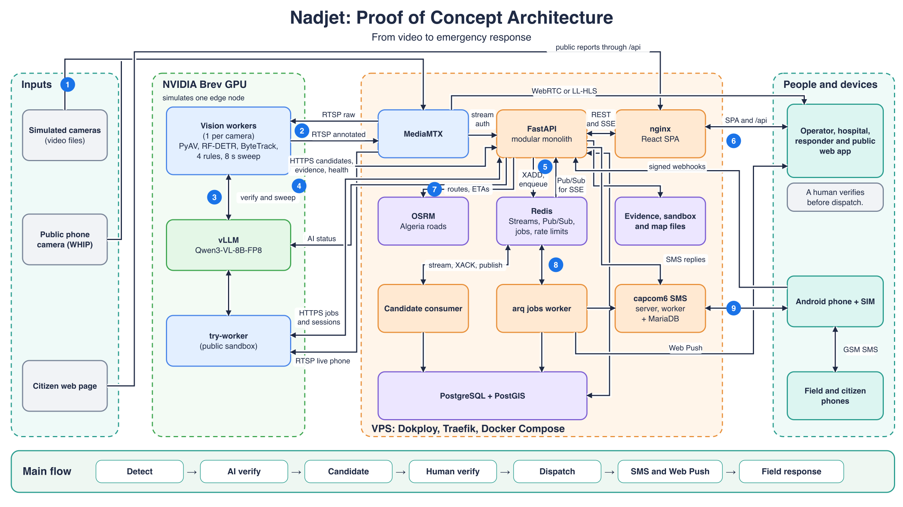

# 01 — System overview

Nadjet has two compute locations today.

| Location | Runs | Why |
|---|---|---|
| **NVIDIA Brev GPU** | vLLM, one vision worker per camera, try-worker | AI needs a GPU. This instance simulates one future edge node. |
| **VPS** | MediaMTX, API, consumer, jobs worker, PostGIS, Redis, OSRM, SMS server, web | Coordination needs no GPU. |

## Design choices that shape everything

| Choice | Reason | Decision |
|---|---|---|
| Modular monolith for the API | One deployable; clear modules | See [decision log](../Decisions/01-decision-log.md) |
| One worker process per camera | One failing camera can't stop the others | TD-37 |
| Redis Stream between ingest and database | Accept candidates quickly; acknowledge only after commit | [Wiring](02-component-wiring.md) |
| Generated contracts | OpenAPI, event schemas and the TS client can't drift unnoticed | `make gen`, `make check-contracts` |
| Brev-only inference | One controlled AI endpoint, no silent degradation | `AGENTS.md`, FR-VIS-009 |
| Human verification gate | Safety; AI informs a decision and doesn't make it | PRD |

## Detailed wiring

