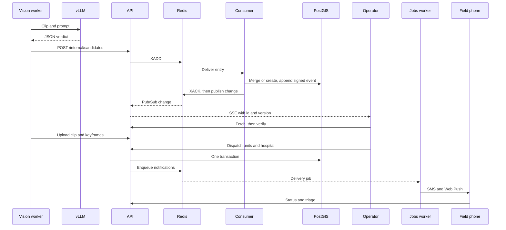
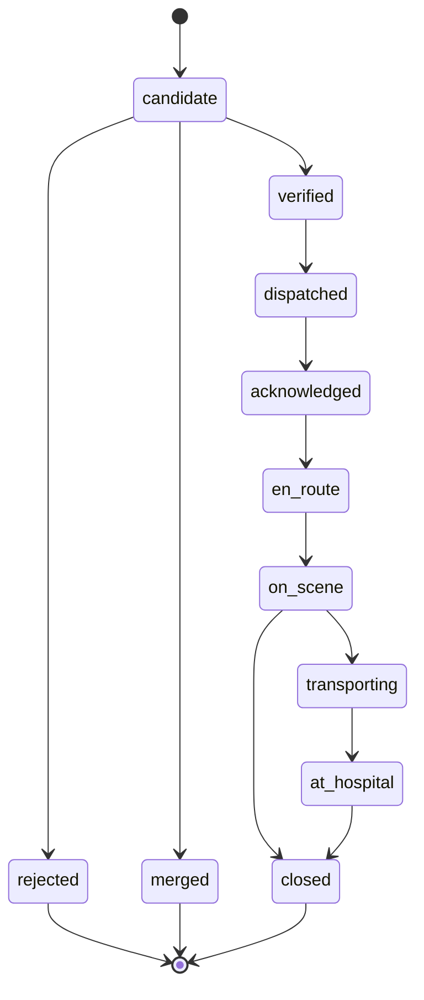

# 03 — Incident lifecycle

## From camera to field

The worker verifies a rule candidate **before** posting it, so the operator doesn't see an unverified status flip. If the AI is unavailable, the candidate still goes out, labelled.

## State machine

From `services/api/src/nadjet_api/incidents/lifecycle.py`.

Reject reasons are `false_positive`, `duplicate`, `not_emergency` and `other`.

## Merging

An open incident absorbs a new report that is close in space and time: within 50 m (`MERGE_RADIUS_M`) and, for different sources, within 60 s (`MERGE_WINDOW_S`). Reports from the same camera use their own window. See `incidents/merge.py`.

## Priority

Priority runs from P1, the most urgent, to P4 (`incidents/priority.py`). Each fired rule sets a minimum, and the final level is the most urgent minimum. Night, highway and an AI raise add at most one level together, and the AI never lowers it. Triage, once present, replaces the AI raise and the context bump. A bus involved, or five or more victims, marks a mass-casualty incident.

Each priority keeps its reasons, with their rule or model source.

> Some signals are not fed yet. See limitation 6 in [Status and limits](../Overview/03-status-and-limits.md).

## Dispatch needs

From `dispatch/need.py`:

| Situation | Agencies that can respond | Hospital capability |
|---|---|---|
| Normal | Civil Protection, SAMU | `emergency` |
| Priority 1–2 or mass casualty | Civil Protection, SAMU | `trauma` |
| Someone trapped | Civil Protection only | `trauma` |
