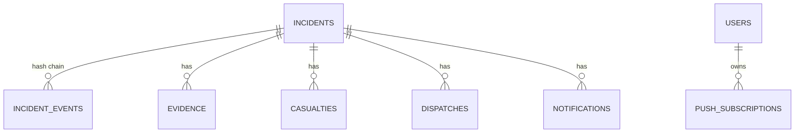

# 04 — Data model

PostgreSQL with PostGIS is the system of record. Schema changes are Alembic migrations in `services/api/src/nadjet_api/migrations/versions/`.

## Tables

| Table | Holds | Notable columns |
|---|---|---|
| `incidents` | Current state of each incident | `short_code`, `status`, `priority`, `priority_reasons`, `ai_status`, `verifier_result`, `source`, `merged_into`, `version` |
| `incident_events` | Append-only history | `kind`, `payload`, `idempotency_key`, `prev_hash`, `hash`, `signature` |
| `evidence` | Clips and keyframes | `kind`, `path`, `sha256`, `start_ts`, `end_ts` |
| `casualties` | Triage entries | `triage_tag`, `avpu`, `resp_rate`, `pulse`, `spo2`, `source` |
| `dispatches` | Unit and hospital assignments | `unit_id`, `hospital_id`, `eta_s`, `distance_m`, `route` |
| `notifications` | One row per delivery | `kind`, `channel`, `recipient`, `status`, `attempts`, `provider_ref` |
| `cameras` | Camera registry | `stream_path`, `lat`, `lon`, `road`, `pk_km`, `zones`, `status`, `simulated` |
| `users` | Accounts | `role`, `agency`, `facility_id`, `password_hash` |
| `push_subscriptions` | Web Push endpoints | `endpoint`, `p256dh`, `auth` |
| `audit_log` | Staff action trail | `actor_id`, `action`, `target_type`, `prev_hash`, `hash` |
| `try_jobs`, `try_sessions` | Public sandbox | Deliberately no foreign keys to incidents |

Units and facilities have their own tables, loaded from `data/seed/*.csv`. `make seed-geo` imports them.

## Stored outside the database

| Data | Where |
|---|---|
| Evidence files | Local volume, behind the `EvidenceStore` protocol |
| Sandbox uploads | `NADJET_TRY_DIR`, purged after the TTL |
| Map tiles | `algeria.pmtiles` |
| Stream entries, live events, jobs, health | Redis |

## Rules

- `incidents.version` lets clients detect stale data.
- Audit and event tables are append-only, enforced by database triggers.
- Sandbox results stay in `try_jobs`, so the queue, KPIs and evaluation can't see them (TD-46).
