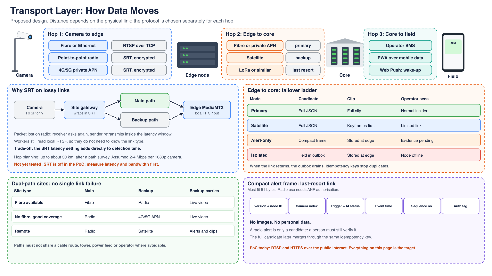

# 06 — Transport and connectivity

**The PoC uses RTSP and HTTPS over the public internet. Everything else on this page is proposed.** SRT is off in the PoC and untested.

## Why each hop is separate

Distance depends on the physical link, not on the streaming protocol, so each layer is chosen on its own.

| Hop | Link | Protocol | Carries |
|---|---|---|---|
| Camera to edge | Fibre or Ethernet | RTSP over TCP | Live video |
| Camera to edge | Point-to-point radio | SRT | Live video |
| Camera to edge | 4G/5G private APN | SRT | Live video |
| Edge to core | Closed fibre or private APN | HTTPS with mTLS | Candidates, clips, health |
| Edge to core | Satellite | HTTPS with mTLS | Candidates, keyframes first |
| Edge to core | LoRa or similar | Compact frame | Short alert only |
| Core to field | Operator SMS, mobile data | SMS, PWA, Web Push | Alerts and replies |

Radio links need ANF authorisation. Bandwidth (2–4 Mbps per 1080p camera) and range (about 30 km per hop) are planning assumptions until measured.

Full design: [production target, section 2.5](09-production-target.md).
