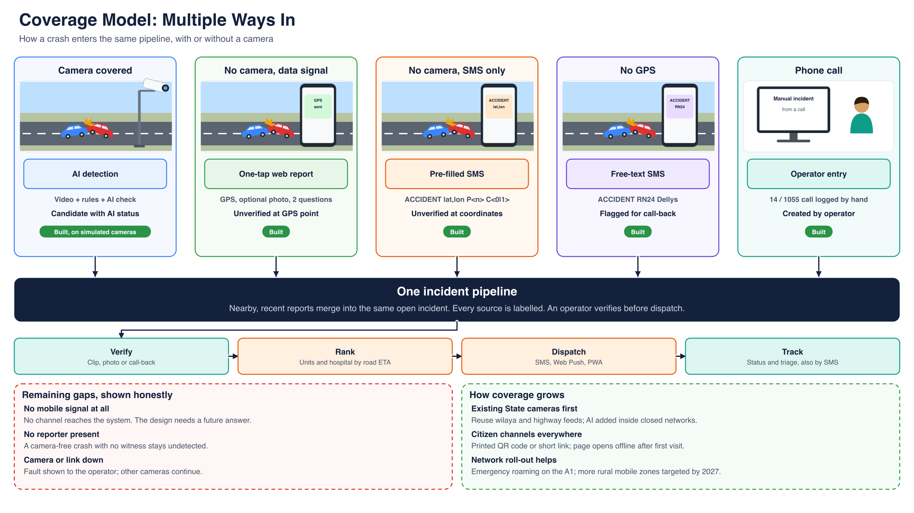

# 07 — Coverage model

Cameras cover a small part of the road network, so Nadjet has several ways in. They all reach the same pipeline, and a person verifies each one.

| Situation | Channel | What the system receives | Result |
|---|---|---|---|
| Camera covered | AI detection | Video, rule, AI status | Candidate with AI status |
| No camera, data signal | One-tap web report (FR-CIT-006) | GPS, optional photo, two witness questions | Unverified incident at the GPS point |
| No camera, SMS only | Pre-filled SMS | `ACCIDENT <lat>,<lon> P<n> C<0\|1>` | Unverified incident at the coordinates |
| No GPS | Free-text SMS | `ACCIDENT <text>` | Flagged for operator call-back |
| Phone call | Operator entry, `POST /incidents` | Operator's notes | Incident created by the operator |

## Open gaps

| Gap | Current answer |
|---|---|
| No mobile signal at all | None. The design needs a future answer. |
| Crash with no camera and no witness | Stays undetected |
| Camera or link down | Fault shown to the operator; a dead worker doesn't yet raise an active alert |

## How coverage grows

- Add AI to existing State cameras, inside closed networks. This is proposed.
- Spread the report page with a printed QR code or short link. It opens offline after the first visit.
- Mobile rollout helps: emergency roaming on the East-West Highway since May 2025, and more rural zones targeted by 2027, per `docs/02-algeria-research.md`.
