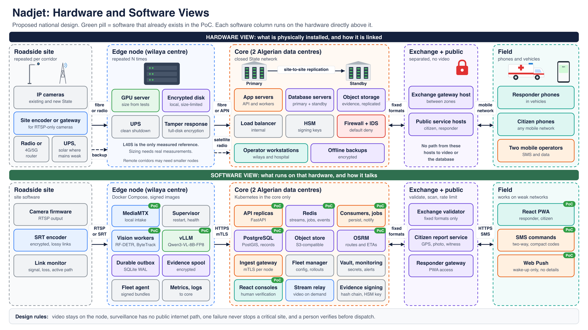

# 08 — Hardware and software

**This diagram shows the proposed national design.** Each software column runs on the hardware directly above it. Green pills mark software that exists in the PoC, although production would change it.

## PoC hardware today

| Hardware | Role |
|---|---|
| One NVIDIA Brev GPU instance, L40S | Vision and AI |
| One VPS, at least 4 vCPU, 8 GB RAM, 60 GB disk | Everything else |
| One Android phone with a SIM | SMS gateway |
| Simulated cameras | Video files on the VPS |

## Sizing

Don't size the GPU fleet from assumptions. L40S is the only measured reference, and cameras-per-GPU is still unknown. The method is in [production target, section 2.6](09-production-target.md).
