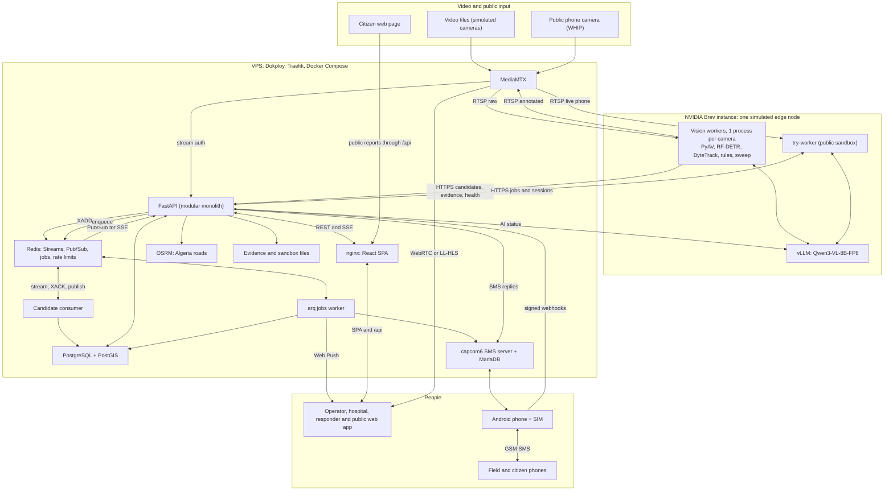
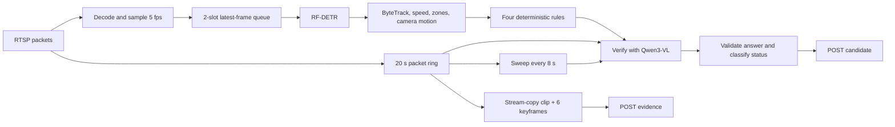
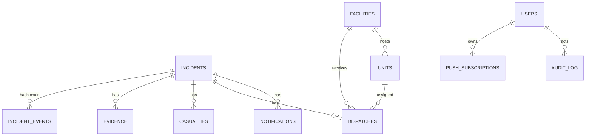
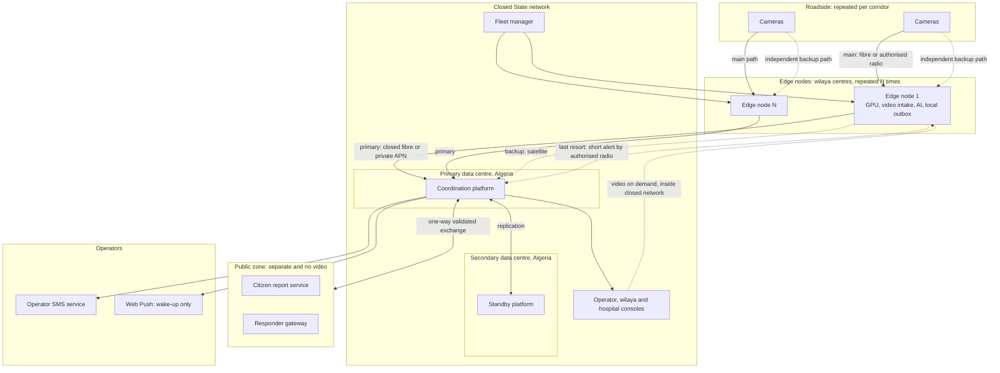
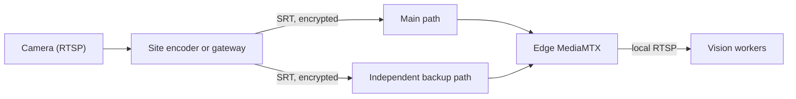
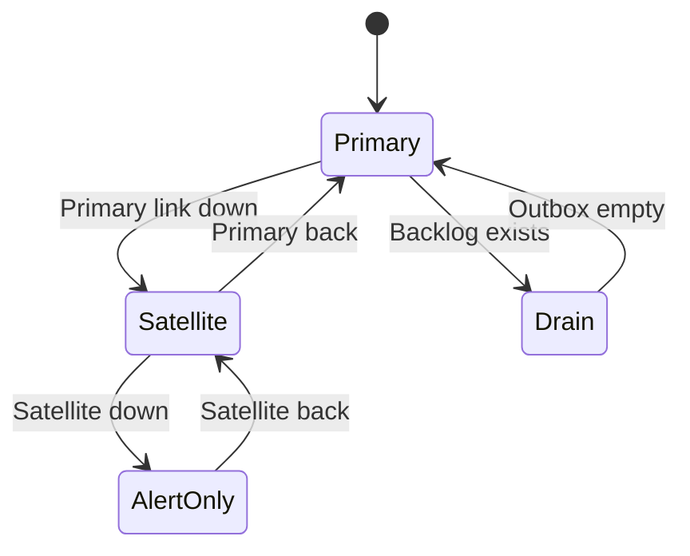
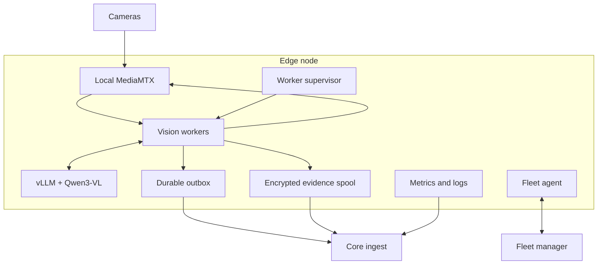
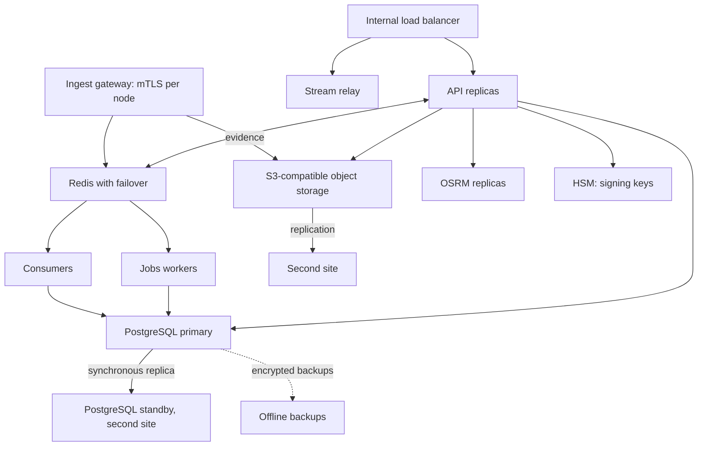
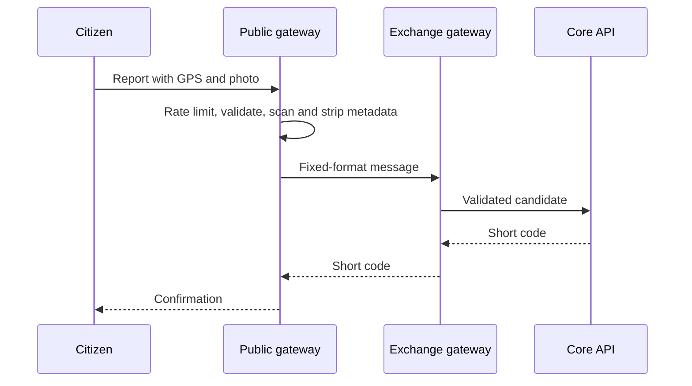

> Copied from `docs/SYSTEM-DESIGN.md` in the `nadjet` repository. Part 1 describes what exists; Part 2 is a proposal. The legal reading is an engineering input, not legal advice.

# Nadjet system design: PoC and production target

Status: draft for review. Date: 2026-10-31.

This document has two parts:

- **Part 1** describes the proof of concept as it exists in this repository.
- **Part 2** is a proposed production design for national deployment. **None of Part 2 is built
  unless Part 1 says so.**

Technical decisions in `docs/11-technical-decisions.md` remain the source of truth for the PoC.
Part 2 proposes future decisions and does not change any of them.

The legal analysis comes from a reading of the Algerian texts listed in
[Legal sources](#legal-sources). It is an engineering input, not legal advice. Algerian counsel
must confirm it before any deployment.

| Marker | Meaning |
|---|---|
| **[B]** | Built in the PoC |
| **[P]** | Proposed, not built |
| **[M]** | Must be measured before the design can be finalised |
| **[L]** | Needs a legal or regulatory answer |

---

## Summary

| | PoC today | Production target |
|---|---|---|
| Purpose | Prove the full chain from video to rescue | Run as part of a State emergency service |
| Operator | Project team | State operator, with Nadjet as vendor **[L]** |
| Cameras | 4 simulated, from video files | Existing and new State cameras |
| AI location | One rented NVIDIA Brev GPU instance | Edge nodes on Algerian premises |
| Video path | VPS → GPU server → VPS, over the internet | Stays local; no public internet path |
| Camera links | None; video is played from files | Dual-path fibre or radio, with SRT on lossy links |
| Central platform | One VPS with Docker Compose | Two sites in Algeria with failover |
| Evidence | Files on one VPS disk | Replicated object storage |
| Field alerts | One Android phone and SIM, plus Web Push | Operator SMS service, with redundancy |
| Backup links | None | Satellite and, if authorised, LoRa alerts |

The main design change is not scale. It is moving from a system connected through the public
internet to one that can operate inside a closed State network.

---

# Part 1: PoC architecture (as built)

## 1.1 Goal

The PoC proves that one system can detect a crash on video, have the AI check it, let a human
verify it, dispatch units and a hospital, and carry the field response over SMS or the web app.

In the target design, the Brev instance stands in for one edge node.

## 1.2 Architecture



## 1.3 Components

| Component | Runs on | Responsibility |
|---|---|---|
| Vision worker | Brev | Reads video, detects, tracks, applies rules, verifies, publishes |
| vLLM + Qwen3-VL | Brev | Verification and sweep; structured JSON with logprobs |
| try-worker | Brev | Public clip analysis and phone sessions, isolated from incidents |
| MediaMTX | VPS | RTSP and WHIP in; WebRTC and LL-HLS out |
| API | VPS | Incidents, dispatch, auth, hospitals, KPIs, admin, sandbox |
| Consumer | VPS | Persists candidates; acknowledges after the database commit |
| Jobs worker | VPS | Sends notifications, with retries |
| PostgreSQL + PostGIS | VPS | System of record |
| Redis | VPS | Queue, live events, jobs, rate limits, short-lived health |
| OSRM | VPS | Road ETAs and routes |
| SMS server + Android | VPS + phone | Two-way SMS |
| React app | Browser | Operator, responder, hospital and public surfaces |

## 1.4 Detection pipeline



| AI status rule | Result |
|---|---|
| Rule fired and AI says yes with p ≥ 0.8 | `confirmed` |
| Rule fired and AI unavailable, or yes with 0.5 ≤ p < 0.8 | `probable` |
| Rule fired and AI says no, or yes with p < 0.5 | `possible` |
| Rule fired and AI cannot judge | `insufficient_evidence` |
| Sweep hit once | `possible` |
| Sweep hit twice in a row | `probable`, the maximum for a sweep |

These thresholds are untuned starting values (TQ-07). The AI uses no RAG, embeddings, tools, agents,
fine-tuning or conversation memory.

## 1.5 Incident flow

```mermaid
sequenceDiagram
  participant W as Vision worker
  participant V as vLLM
  participant A as API
  participant R as Redis
  participant C as Consumer
  participant P as PostGIS
  participant O as Operator
  participant J as Jobs worker
  participant F as Field phone

  W->>V: 20-frame video + prompt
  V-->>W: JSON verdict + logprobs
  W->>A: POST /internal/candidates
  A->>R: XADD
  R-->>C: Deliver entry
  C->>P: Merge or create; append signed event
  C->>R: XACK, then publish change
  R-->>O: SSE (via API): id and version
  O->>A: Fetch, then verify
  W->>A: Upload clip and keyframes
  O->>A: Dispatch units and hospital
  A->>P: One transaction
  A->>R: Enqueue notifications
  R-->>J: Delivery job
  J->>F: SMS and Web Push
  F->>A: Status and triage
```

## 1.6 Data model



`try_jobs` and `try_sessions` deliberately have no foreign keys to these tables.

## 1.7 Security as built

| Area | Implementation |
|---|---|
| Users | Argon2id passwords; 30-minute HS256 JWT; no refresh |
| Roles | Operator, supervisor, responder, hospital, auditor, admin |
| Data scope | Responders by agency, hospitals by facility |
| Services | One shared `NADJET_INGEST_TOKEN` |
| Streams | MediaMTX delegates auth to the API; short-lived stream tokens |
| Evidence | SHA-256, per-incident hash chain, Ed25519 signature |
| Audit | Append-only tables, enforced by database triggers |
| AI endpoint | Loopback or allow-listed Brev host only |

## 1.8 Known limitations

| # | Limitation | Severity |
|---|---|---|
| 1 | Internet-connected video path can't be used with real cameras (see 2.2) | Blocks production |
| 2 | AI runs on foreign-owned cloud; server location unconfirmed | Blocks production |
| 3 | Candidates are lost after about 15.5 s of failed posts or on a worker restart | High |
| 4 | Single VPS, single GPU instance and single SMS phone | High |
| 5 | Operators are logged out every 30 minutes | High |
| 6 | Fire, rollover and vehicle counts from AI don't feed priority | High |
| 7 | An undelivered SMS warns the operator only after 450 s | High |
| 8 | Public rate limits are probably shared behind the proxy (confirm on deployment) | High |
| 9 | `/system/ai` probably reports unavailable in production (confirm on deployment) | Medium |
| 10 | Retention makes the integrity check report invalid | Medium |
| 11 | Admin camera edits don't reach workers | Medium |
| 12 | Evaluation applies a veto that live operation doesn't | Medium |
| 13 | A dead worker raises no active alert | Medium |
| 14 | Event chain can't detect tail truncation | Medium |
| 15 | No recorded latency, accuracy or false-alarm results yet | High for claims |

### Capacity warning

TD-50 measured about 6.5 s for one verifier call alone, and about 11 s each with two at once. That
is about 0.18 calls per second. Four cameras sweeping every 8 s want 0.5 calls per second.

Sweep clips are smaller than verifier clips, so this comparison is only an estimate, but sweeps may
be skipped often under load. **[M]** This must be measured before any camera-per-GPU figure is used.

---

# Part 2: Production system design (proposed)

## 2.1 Design principles

1. **A human verifies before dispatch.** No automation path may bypass it.
2. **Video stays local.** Only evidence and metadata leave a node.
3. **No public internet path to surveillance systems.**
4. **Every failure is visible.** The system never invents data or silently degrades.
5. **Keep working when isolated.** An edge node must hold its data until the link returns.
6. **Data stays in Algeria.** Personal data and models are hosted on Algerian premises.
7. **Reuse the PoC contracts.** Keep candidates, idempotency keys and status rules.
8. **Stay simple.** Add infrastructure only where a real requirement needs it.

## 2.2 Legal constraints that shape the design

| Rule | Source | Design response |
|---|---|---|
| Surveillance of major roads is carried out by State means | Decree 15-228, Arts. 4, 5 | Nadjet is software deployed for a State operator **[L]** |
| Outside urban zones, the gendarmerie is responsible | Decree 15-228, Art. 12 | Gendarmerie is a stakeholder for rural corridors |
| Wilaya centres are under the wali; Civil Protection connects on request | Decree 15-228, Arts. 10, 11 | Wilaya centres are the default edge location |
| Surveillance systems can't connect to the internet | Decree 09-410, Art. 20 bis | Closed network; separate public zone **[L]** |
| Surveillance equipment is sensitive | Decree 09-410, Annex I | Licensed partner for supply and installation |
| Night-vision surveillance falls under war-materiel rules | Decree 09-410, Annex I footnote | Legal check before specifying night cameras **[L]** |
| Radio stations need authorisation, with three ministries' agreement | Law 20-04, Arts. 7, 9 | Radio links only after ANF authorisation |
| Licence-free low-power networks must be internal | Law 18-04, Arts. 3, 138, 139 | Roadside radio treated as an authorised private network |
| Foreign radio links need approval | Law 20-04, Art. 18 | No foreign satellite service without approval |
| Personal data processing needs declaration or authorisation | Law 18-07, Art. 12 | ANPDP filing before go-live |
| Transfers abroad are restricted | Law 18-07, Arts. 44, 45 | No personal data leaves Algeria by design |
| Triage data is sensitive health data | Law 18-07, Arts. 3, 18 | Stronger access control and encryption |
| Controllers appoint a data protection officer and keep registers | Law 25-11 (Art. 41 bis onward) | DPO, register and automated operations log |
| Only qualified seals and timestamps carry legal presumptions | Law 26-02, Arts. 8, 15 | Qualified seal and timestamp on evidence |
| Public bodies must set up security structures and subcontract clauses | Decree 26-07 | Contract security annex for each client |

## 2.3 Topology



| Tier | Location | Holds | Must survive |
|---|---|---|---|
| Site | Roadside | Cameras, encoder and two independent links | Power loss and loss of one link |
| Edge | Wilaya centre or equivalent | Live video buffer, AI, unsent candidates | Central link loss |
| Core | Two Algerian data centres | Incidents, evidence, users, routing | Loss of one site |
| Public | Separated zone | Validated reports in transit | Attack, without reaching the core |
| Field | Phones and hospitals | Offline action queue | No data connection |

Whether a node serves one wilaya, or corridors need nodes of their own, depends on the capacity
measurements. **[M]** Remote corridors may need a smaller roadside node.

## 2.4 Network zones

| Zone | Contains | Rule |
|---|---|---|
| Video zone | Cameras and edge intake | No route to the internet |
| Edge service zone | Workers, vLLM, outbox, fleet agent | Outbound only, to the core |
| Core zone | API, data stores, consoles | Reachable through closed links only |
| Exchange zone | Validation gateway | Accepts fixed message formats only |
| Public zone | Citizen and responder gateways | No video and no direct database access |

**[L]** Counsel must confirm which transport counts as "not connected to the internet" under Art.
20 bis, and whether an encrypted tunnel over public infrastructure is acceptable. This design assumes
it isn't, and uses dedicated fibre, leased lines or a private APN.

## 2.5 Communication layers

Distance depends on the physical link, not the streaming protocol, so each layer chooses them
separately. Fibre is the preferred link where it exists. Point-to-point radio is the main option
where it doesn't. Radio is dependable only when it is designed and backed up properly, so no critical
site relies on a single path.

| Layer | Link | Carries | Status |
|---|---|---|---|
| Camera to edge | Fibre or Ethernet | Live video over RTSP | Preferred |
| Camera to edge | Point-to-point radio | Live video over SRT | Needs ANF authorisation **[L]** |
| Camera to edge | 4G/5G on a private APN | Live video over SRT | Coverage and bandwidth to confirm **[M]** |
| Edge to core, primary | Dedicated fibre or private APN | Candidates, clips, health, updates | Preferred |
| Edge to core, backup | Satellite through an authorised provider | Candidates and small clips | Capacity to confirm **[M]** |
| Edge to core, last resort | LoRa or similar, on a compact frame | Short alert only | Needs ANF authorisation **[L]** |
| Core to field | Operator SMS service and PWA | Alerts and replies | Terms to confirm |

### Camera-to-edge video [P]



Up to about 30 km is the planning distance for a point-to-point hop, subject to a path survey.

| Decision | Choice | Why |
|---|---|---|
| Protocol on clean fibre | RTSP over TCP | The PoC already uses it, and it adds no recovery delay |
| Protocol on radio or cellular | SRT | Recovers lost packets and supports encryption and configurable latency |
| Alternative | RIST | Reasonable, but SRT is simpler to start with |
| Not used on this link | RTMP, HLS, WebRTC | They don't suit camera contribution over lossy links |
| Worker input | Unchanged local RTSP | Workers don't need to know about the link type |
| Site hardware | Encoder or gateway when a camera offers only RTSP | Many cameras don't speak SRT |

The SRT latency setting adds directly to detection time, so it must be measured against SC-001.
**[M]** The PoC's generated MediaMTX config has SRT switched off, and SRT is untested in this project.
Prove it first with one simulated camera on a deliberately lossy link.

Bandwidth is an assumption until measured: 2–4 Mbps per 1080p H.264 camera, so 8–16 Mbps plus
headroom for four cameras. **[M]**

### Dual-path sites [P]

Every critical site has two independent paths, so one failure doesn't stop its video.

| Site type | Main path | Backup path | Backup carries |
|---|---|---|---|
| Fibre available | Fibre | Point-to-point radio | Live video |
| No fibre, good coverage | Point-to-point radio | 4G/5G private APN | Live video, at reduced quality if needed |
| Remote | Point-to-point radio | Satellite | Alerts and clips, not continuous video |

The paths must not share a cable route, tower, power feed or operator where that can be avoided.

| Requirement | Design |
|---|---|
| Failover | Automatic, with a target of a few seconds **[M]** |
| Failback | Only after the main path stays stable, to avoid flapping |
| Power | UPS at both ends; solar where mains supply is weak |
| Radio budget | Fade margin for rain and sand, with a licensed frequency set through the ANF process **[L]** |
| Critical links | Second radio where a tower failure would stop several cameras |
| Path survey | Terrain, obstacles, Earth curvature and Fresnel clearance |
| Monitoring | Signal strength, packet loss and SRT retransmissions; alert before the link fails |
| Operator view | Show which path each camera is using, and when it has no backup |

As a planning figure, a flat 30 km hop at 5 GHz needs about 26 m of clearance at mid-path, which is
about 13 m for Earth's curve and 13 m for 60% Fresnel clearance. Hills and buildings add to this.

### Edge-to-core failover order



| Mode | Candidate | Clip | Operator sees |
|---|---|---|---|
| Primary | Full JSON | Full clip | Normal incident |
| Satellite | Full JSON | Keyframes first, clip if capacity allows | "Limited link" |
| Alert-only | Compact frame | Stored at the edge | "Link degraded: evidence pending" |
| Isolated | Stored in the outbox | Stored at the edge | "Node offline" |

### Compact alert frame [P]

The frame must fit 51 bytes, the smallest EU868 LoRaWAN payload, and needs regional validation.

| Field | Purpose |
|---|---|
| Version and node ID | Routing |
| Camera index | Location lookup at the core |
| Trigger and AI status | Triage |
| Event time | Ordering |
| Sequence number | Duplicate detection |
| Authentication tag | Rejects forged alerts |

No images or personal data use this link. A radio alert creates a candidate that a human must still
verify, and the full candidate later merges through its idempotency key.

## 2.6 Edge node



| Part | Choice | Why |
|---|---|---|
| Runtime | Docker Compose with signed images | Matches the PoC; simple on one host |
| Outbox | SQLite in WAL mode | One writer per node; survives restarts; no new service |
| Evidence spool | Encrypted local disk, size-limited | Holds clips during outages |
| Core sync | Retry until acknowledged, with existing idempotency keys | Closes the candidate-loss gap |
| Identity | Unique mTLS certificate per node | One stolen node can't impersonate others |
| AI | vLLM on loopback | Already what the code expects |
| Disk | Full-disk encryption and tamper response | Nodes are physically exposed |
| Power | UPS sized for a clean shutdown | Protects the outbox |
| Hardware | Server-grade GPU host, size from measurement **[M]** | L40S is the only measured reference |

Workers report candidates to the outbox first, so a central outage no longer stops or drops them.

### Sizing method

Don't size from assumptions. For each candidate GPU, measure on representative traffic and record:

| Input | Why it matters |
|---|---|
| Detector time per frame | Limits cameras at 5 fps |
| Verifier time, alone and under load | Limits detection delay |
| Sweep time under load | Sets the real sweep interval |
| NVENC session and throughput limits | Limits annotated streams |
| Candidates per camera-hour | Sets verifier load |

```
cameras per node = the lowest of:
  detector capacity  = GPU frames per second / 5
  sweep capacity     = AI calls per second × sweep interval
  encoder capacity   = supported annotated streams
```

Reduce GPU load before buying more hardware:

- Share one detector across cameras using batched inference, not one model per process.
- Trigger sweeps on unusual scene changes instead of a fixed timer. **[M]** Check this doesn't reduce
  recall.
- Keep annotated streams on demand for the cameras being watched.
- Give rule verification priority over sweeps.

## 2.7 Core platform



| Service | PoC | Production |
|---|---|---|
| API | 1 container | Stateless replicas behind a load balancer |
| Consumer, jobs | 1 each | Multiple workers; both designs already allow this |
| PostgreSQL | 1 container | Primary and synchronous standby, with point-in-time recovery |
| Redis | 1 container | Replicated with automatic failover |
| Evidence | Local volume | S3-compatible storage; `EvidenceStore` is the seam |
| Orchestration | Compose | Kubernetes in the core only, where replicas justify it |
| Secrets | `.env` | Vault service; HSM for signing keys |
| Signing | Ed25519 key in env | HSM key, external anchor and qualified seal **[L]** |

Check object-store licences against NFR-LIC-001. For example, MinIO is AGPL, so it would need review,
while SeaweedFS is Apache-2.0.

The global advisory lock on incident creation should become a per-area lock if measured load needs
it. KPIs should move from in-memory aggregation to SQL before their noted limit.

## 2.8 Fleet manager [P]

The core must be able to manage nodes it can't physically reach.

| Function | Design |
|---|---|
| Registry | Each node, its cameras, versions and certificate |
| Configuration | Cameras, zones and thresholds stored centrally and pushed as signed, versioned bundles |
| Software | Signed images; staged rollout; automatic rollback |
| Models | Pinned by hash, as in `models.lock.yaml`; re-evaluated before rollout |
| Health | Node, camera, GPU, link mode and outbox depth |
| Alerts | Missing heartbeat raises an active alert |
| Revocation | A stolen node's certificate can be revoked at once |

This fixes the PoC issue where admin edits never reach workers: the database becomes the single
source, and nodes run the last signed bundle while offline.

## 2.9 Video access

| Rule | Design |
|---|---|
| Default | Video stays on the node |
| Live viewing | Authorised console in the closed network requests a stream on demand |
| Bandwidth | Only watched streams leave a node |
| Authorisation | Short-lived stream tokens, as in the PoC |
| Audit | Each view is logged with user, camera and time |
| Evidence | Only clips for an incident go to the core |
| Retention | Local ring only; no continuous recording by Nadjet |

## 2.10 AI improvements

| Change | Why |
|---|---|
| Feed the verifier's `type` and vehicle count into priority, marked "needs human check" | Rollover and fire can reach P1/P2 |
| Add a licence-cleared fire and smoke signal | Currently only the operator can report these |
| Tune thresholds on non-held-out Algerian footage | Current values are untested |
| Align evaluation with live behaviour | Today's veto doesn't exist in production |
| Add a shadow mode for each new model | Compare before it affects operators |
| Add operator feedback review | Rejections become labelled evaluation data |
| Test at night, in rain and in sandstorms | Conditions in public datasets differ |

Any model update must pass the evaluation harness on held-out data, with results recorded, before a
staged rollout. Automatic retraining isn't proposed.

## 2.11 Notifications and field access

| Channel | Production design |
|---|---|
| SMS | Business service from at least two operators, chosen by network health |
| Web Push | Wake-up signal only, with no incident details, because it passes through vendor services |
| PWA | Fetches details after login, through the responder gateway |
| Telegram | Disabled |
| Escalation | No delivery in 60 s **[M]** alerts the operator; a voice call is the fallback |

The 450 s failure warning in the PoC is replaced by a delivery timer visible on the dispatch screen.

Hospital and agency users should connect from their own closed or managed networks where possible.
**[L]** Responder phones on public mobile data need review, even though they handle no camera video.

## 2.12 Public services

Citizen reporting stays public, in the separated zone.



The "try it yourself" sandbox is a demo feature. It should not run in production. If it's kept for
public education, it needs separate infrastructure with explicit consent, and no link to the core.

## 2.13 Identity and security

| Area | Production design |
|---|---|
| Staff login | State identity provider or SSO, with MFA |
| Sessions | Short access token plus rotating refresh token |
| Authorisation | Existing roles, plus wilaya scoping and a supervisor role per wilaya |
| Services | mTLS between every service; separate identities per node |
| Secrets | Vault; no shared ingest token |
| Data at rest | Encrypted databases, disks and backups |
| Data in transit | TLS 1.3 throughout **[L]** Check any rules on cryptographic equipment |
| Admin access | Bastion, MFA, session recording and two-person approval for production changes |
| Network | Default deny, one-way flows and intrusion detection |
| Testing | Independent penetration test before go-live, and yearly after |
| Monitoring | Security logging into the client's SOC |

### Privacy

| Requirement | Design |
|---|---|
| Purpose | Emergency response only; no offence detection or person tracking |
| Minimisation | No face recognition or plate reading |
| Faces and plates | Blur on non-essential views where it doesn't harm rescue **[M]** |
| Retention | Evidence for 90 days by default, adjusted to the applicable text **[L]** |
| Health data | Restricted to scoped roles, with access logs |
| Rights | Procedure for access, correction and objection |
| Breach | Runbook aiming at the 5-day ANPDP notification **[L]** |
| Governance | DPO, processing register, operations log and impact study |

The controller is expected to be the State operator, with Nadjet as a processor under a written
contract (Law 18-07, Art. 39). **[L]**

## 2.14 Reliability targets

These are proposed targets, not measurements. Each must be agreed with the operator.

| Measure | Proposed target |
|---|---|
| Core availability | 99.9% monthly |
| Recovery after primary site loss (RTO) | 15 minutes |
| Data loss after primary site loss (RPO) | Zero for committed incidents |
| Candidate loss during a link outage | Zero, up to spool capacity |
| Edge node replacement | Next business day, with a spare per region |
| Impact to operator screen | ≤ 10 s median, as in SC-001 |
| Confirm to SMS delivered | ≤ 15 s, as in SC-002 |

### Failure modes

| Failure | Behaviour |
|---|---|
| Camera fails | Fault alert; other cameras continue |
| One camera path fails | Automatic switch to the backup path; "no backup" warning until repaired |
| Both camera paths fail | Camera fault alert; other cameras continue |
| Radio link weakens | Warning from signal and loss trends, before it fails |
| GPU fails | Node alert; rules and AI stop at that node, and citizen channels continue |
| AI fails, GPU healthy | Rule-only candidates, labelled |
| Central link fails | Node runs locally; outbox holds data; failover begins |
| All links fail | Node stores evidence; "node offline" alert after missed heartbeats |
| Primary data centre fails | Standby takes over, nodes reconnect and replay the outbox |
| Redis fails | Failover; nodes retry; database remains the truth |
| OSRM fails | Replica serves; if all fail, dispatch continues without invented ETAs, labelled "no ETA" |
| SMS operator fails | Second operator, then voice |
| Node stolen | Certificate revoked, encrypted disks unreadable, incident recorded |

The PoC refuses dispatch when OSRM is down. In production, an operator must still be able to dispatch
manually, because an ETA is not essential to sending help.

## 2.15 Observability

| Signal | Tool type | Examples |
|---|---|---|
| Metrics | Prometheus-compatible | FPS, stage latency, outbox depth, GPU use, link mode, active path, signal strength, SRT retransmissions |
| Logs | Central log store, with no personal data | Service and security events |
| Traces | Candidate ID across services | Impact to screen, by stage |
| Product KPIs | Existing KPI page | Detection, verification and response times |
| AI quality | Scheduled review | False-alarm rate, cannot-judge share, invalid answers |
| Paging | On-call rota | Node offline, outbox growth, SMS failure |

The time on every node must be synchronised, because incident timing depends on it. Use authenticated
NTP or GPS-disciplined time **[M]**, and alert on drift.

## 2.16 Operations

| Area | Design |
|---|---|
| Environments | Development, staging with simulated cameras, and production |
| Releases | Signed images; contracts tested; staged rollout to nodes |
| Rehearsal | Quarterly failover and outage drills |
| Support | 24/7 on-call, with a runbook per failure mode |
| Spares | Edge spares per region; ready-to-enrol node images |
| Installation | Licensed partner for cameras and radio |
| Training | Operators, responders and hospitals; SMS fallback included |

## 2.17 Migration roadmap

| Phase | Goal | Main work | Exit test |
|---|---|---|---|
| 0: Finish PoC | Honest results | Fix limits 5, 7, 8, 9, 10, 12; run evaluation and rehearsals | `RESULTS.md` filled in |
| 1: Legal and sizing | Know what is allowed and how much | Counsel review, operator partner, GPU measurements | Written opinions and sizing data |
| 2: Edge-ready software | No data loss when isolated | Outbox, per-node identity, local intake, SRT test on a lossy link, on-demand video | Survives pulled-cable tests |
| 3: One real site | Prove it on State infrastructure | One on-premise node, dual-path links, real cameras, ANPDP filing | Failover drill and pilot approval |
| 4: Hardened core | Withstand site loss | HA data stores, object storage, SSO, HSM, operator SMS | Failover drill passes |
| 5: Fleet | Manage many nodes | Fleet manager, signed bundles and rollouts | Remote update and rollback pass |
| 6: Corridor pilot | Real traffic at corridor scale | Several nodes, backup links, tuned thresholds | Agreed KPIs met |
| 7: National rollout | Wilaya by wilaya | Support, spares and training | Per-wilaya acceptance |

Phase 1 comes before major engineering, because its answers could change the network design.

## 2.18 Decisions needed

| # | Question | Owner | Affects |
|---|---|---|---|
| 1 | Who is the State operator and data controller? | Leadership and counsel | Whole model |
| 2 | What transport satisfies Art. 20 bis? Is a VPN acceptable? | Counsel, ASSI or client | Network |
| 3 | Do Law 25-11's breach and impact-study duties bind this processing? | Counsel | Compliance |
| 4 | What retention period applies to this evidence? | Counsel, client | Storage |
| 5 | Which rules apply to night-capable cameras? | Counsel, Interior Ministry | Detection at night |
| 6 | Can a LoRa or microwave network be authorised, and how long will it take? | ANF, counsel | Backup links |
| 7 | Is satellite capacity available, and through whom? | Client, provider | Backup links |
| 8 | What can each mobile operator offer for SMS and private APN? | Operators | Field alerts |
| 9 | How many cameras per GPU? | Engineering | Budget |
| 10 | Can Qwen3-VL be used and hosted under client policy? | Client, counsel | AI |
| 11 | Which frequencies and authorisations apply to point-to-point video links? | ANF, counsel | Camera links |
| 12 | How much SRT latency keeps detection within SC-001? | Engineering | Camera links |
| 13 | Which sites are critical enough for a second radio or tower? | Client, engineering | Budget |

## 2.19 What not to build yet

| Item | Reason |
|---|---|
| Multi-region active-active core | Primary and standby meets the proposed need |
| Kubernetes at the edge | One host per node doesn't justify it |
| Kafka | Redis Streams is enough until load proves otherwise |
| Federated or online learning | No training is planned, and held-out rules are simpler without it |
| Custom hardware | Standard servers are enough for the pilot |

---

## Legal sources

- [Law 18-07, JO n° 34, 2018](https://www.joradp.dz/FTP/JO-FRANCAIS/2018/F2018034.pdf)
- [Law 25-11, JO n° 48, 2025](https://www.joradp.dz/FTP/JO-FRANCAIS/2025/F2025048.pdf)
- [Law 26-02, JO n° 14, 2026](https://www.joradp.dz/FTP/JO-FRANCAIS/2026/F2026014.pdf)
- [Law 20-04, JO n° 21, 2020](https://www.joradp.dz/FTP/JO-FRANCAIS/2020/F2020021.pdf)
- [Law 18-04](https://www.arpce.dz/fr/file/q0e1b5)
- [Decree 15-228](https://www.anac.dz/wp-content/uploads/2025/01/15-228.pdf)
- [Decree 09-410](https://www.arpce.dz/fr/file/a3e9e9)
- [Decree 16-61](https://www.arpce.dz/fr/file/y5f6f3)
- [Decree 21-43](https://www.arpce.dz/fr/file/v4h1f1)
- [Decree 26-97](https://www.arpce.dz/fr/file/b9v0s3)
- [Decree 26-07](https://www.arpce.dz/en/file/j2m9a9)
- [Arrêté of 16 November 2022, JO n° 4, 2023](https://www.joradp.dz/FTP/JO-FRANCAIS/2023/F2023004.pdf)

Not verified from official text: ANPDP Deliberation 02/2026, Presidential Decree 11-383, a
consolidated sensitive-equipment list, Decree 98-96, and mobile operators' SMS terms.
