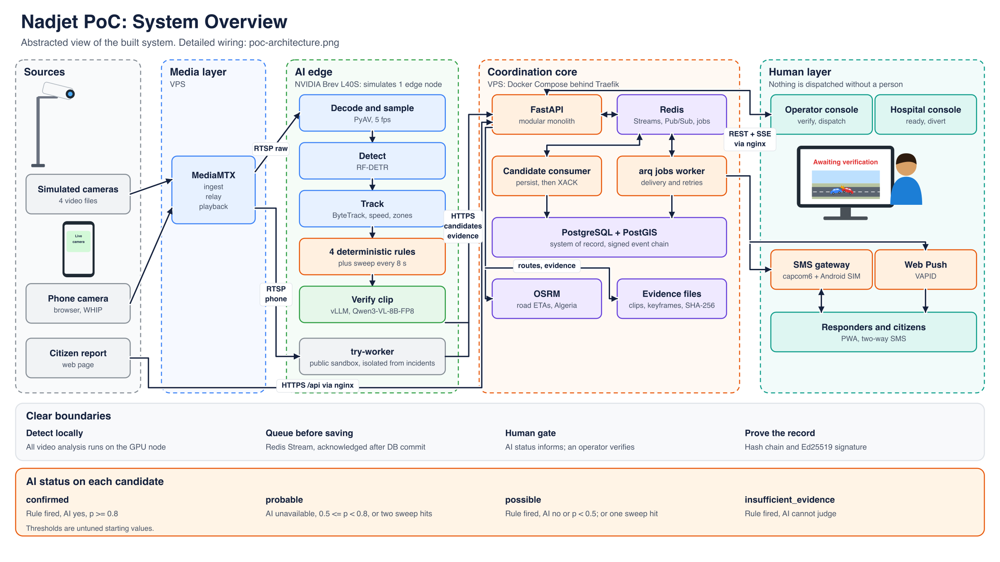

# Nadjet Documentation

Central documentation for **Nadjet (نجاة)**, a platform that detects road crashes on CCTV with AI, collects citizen reports where there are no cameras, and coordinates the emergency response for Algeria.

Everything here was written by reading the [`Nadjeet/nadjet`](https://github.com/Nadjeet/nadjet) repository at `dev` commit `4772da0`. **If a page and the code disagree, the code wins.**

> **Status:** Nadjet is a proof of concept. It runs on simulated cameras from video files. No latency, accuracy or false-alarm results have been recorded yet, and the national design is a proposal. See [Status and limits](Overview/03-status-and-limits.md).

## Start here

| You are | Read this |
|---|---|
| A reviewer with 10 minutes | [What is Nadjet](Overview/01-what-is-nadjet.md), then [System overview](Architecture/01-system-overview.md) |
| A reviewer checking how it is wired | [Component wiring](Architecture/02-component-wiring.md), then [Incident lifecycle](Architecture/03-incident-lifecycle.md) |
| A backend developer | [Back-end](Back-end/00-README.md) |
| An AI or vision developer | [AI](AI/00-README.md) |
| A frontend developer | [Front-end](Front-end/00-README.md) |
| Running or deploying it | [Operations](Operations/00-README.md) |
| Asking why it was built this way | [Decisions](Decisions/00-README.md) |
| Evaluating national deployment | [Production target](Architecture/09-production-target.md) |

## Map of this repository

| Section | Contents |
|---|---|
| [Overview](Overview/) | Product summary, glossary, current status and known limits |
| [Architecture](Architecture/00-README.md) | System overview, wiring, lifecycle, data, security, transport, coverage, hardware and software, production target |
| [AI](AI/00-README.md) | Vision pipeline, model verification, try-it-yourself mode, safeguards, evaluation |
| [Back-end](Back-end/00-README.md) | Code map, API reference, incidents, dispatch, notifications, auth |
| [Front-end](Front-end/00-README.md) | User surfaces, routes and web architecture |
| [Operations](Operations/00-README.md) | Local setup, environment variables, deployment, testing and CI |
| [Decisions](Decisions/00-README.md) | Index of technical decisions |
| [Assets](Assets/diagrams/) | Diagrams used in these pages |

## Source repository map

| Path in `nadjet` | What it is | Stack |
|---|---|---|
| `services/api` | Coordination API, consumer and jobs worker | Python 3.12, FastAPI, SQLAlchemy async, Alembic |
| `services/vision` | Vision workers and AI client | Python, PyAV, RF-DETR, ByteTrack |
| `services/camsim` | Simulated cameras: MediaMTX config and controls | Python |
| `packages/shared` | Event contracts | Pydantic |
| `packages/api-client` | Typed client generated from OpenAPI | TypeScript |
| `apps/web` | Operator, responder, hospital and public web app | React 19, Vite, Tailwind |
| `contracts/` | Generated OpenAPI and event schemas, SMS grammar | Generated, plus one Markdown file |
| `deploy/` | Local, GPU and VPS Compose files | Docker Compose |
| `data/`, `eval/` | Camera catalogue and seeds, evaluation | YAML, CSV, Python |

## Keeping this up to date

1. Change the docs in the same week as the code they describe.
2. Cite source paths, requirement IDs (`FR-…`, in `PRD.md`) and decision IDs (`TD-…`).
3. Mark anything planned as planned. Never present a proposal or an unmeasured number as fact.
4. Use relative links, and put images in `Assets/diagrams/`.
